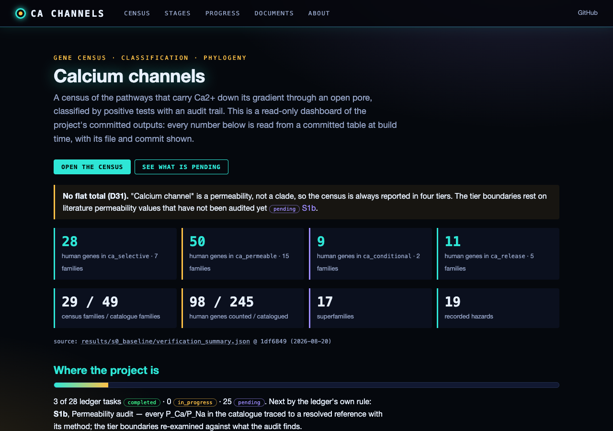
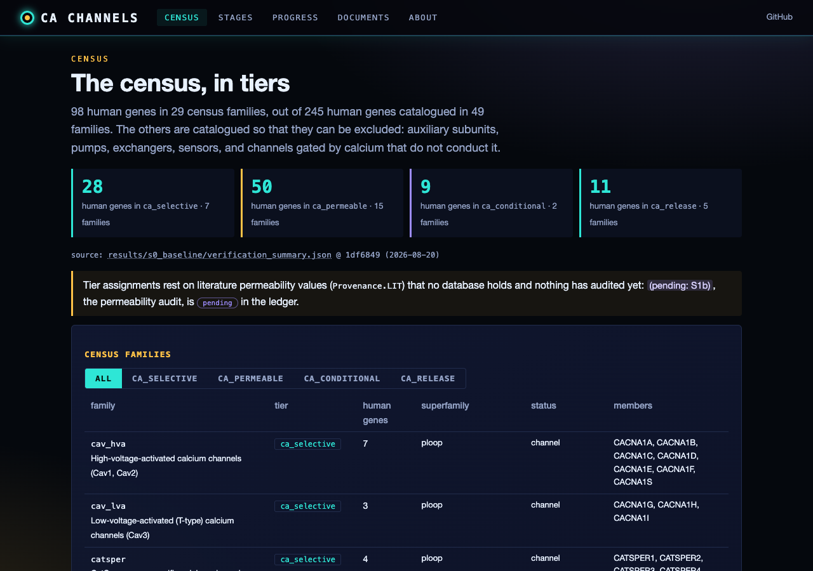
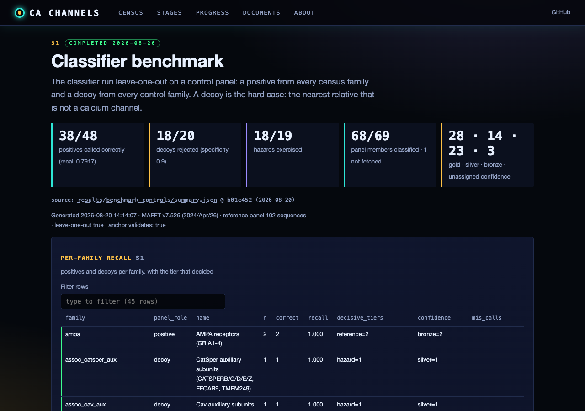
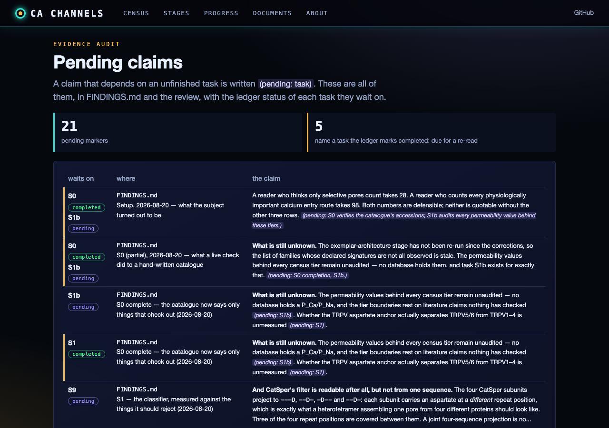

# Calcium channels — census, classification and phylogeny

**Identify, classify and reconstruct the phylogeny of every calcium
channel.** Not one family: the pathways that carry Ca²⁺ down its gradient
through an open pore, across seventeen superfamilies and ninety-eight human
genes, plus their relatives in plants, fungi and viruses.

The subject has a problem a potassium census does not have. **"Calcium
channel" is not a clade, a fold, or a motif — it is a permeability ratio.**
It is measured, in a cell, at a divalent concentration, sometimes per subunit
combination, and in one important case per RNA-editing state of a single
codon. Pores that do it well have arisen independently in at least four
unrelated folds. So the boundary cannot be inherited from the fold or
inferred from the sequence: it has to be declared, tiered, and evidenced.

Three deliverables, in order:

1. **A census** — what exists, in a declared search space, **reported in
   tiers**.
2. **A classification** — what each thing is, by positive tests, with an
   audit trail that says which evidence decided.
3. **A phylogeny** — a forest of within-family and within-superfamily trees
   plus a structural network between them, because the subject spans
   unrelated folds.

---

## Status board

| | |
|---|---|
| **Ledger** | **S0, S1 and S23 complete** (2026-08-20). Next unblocked task: **S1b**, the permeability audit — and S1 raised its priority, because the TRPV tier boundary now rests entirely on unaudited P_Ca/P_Na values. 24 tasks (`PUBLICATION_ROADMAP.md`). |
| **Catalogue** | 49 families · 17 superfamilies · 29 census families · **98 human census genes of 245 catalogued** · 19 hazards · `validate()` clean |
| **Census tiers** | Ca²⁺-selective **28** · store release **11** · Ca²⁺-permeable **50** · conditional **9**. A flat total is never quoted (**D31**). |
| **Verification** | **Complete — one clean pass, 533 requests, 0 failures.** 87 Pfam accessions (0 missing, 0 name mismatches) · 102/102 exemplars resolved to a *declared* accession · 53/53 taxa · **0 family-level architecture mismatches** · reference panel complete at 102 sequences. Across both sessions it produced **19 catalogue corrections and seven tooling defects** — see [`report.md`](results/s0_baseline/report.md) and [`PROVENANCE.md`](results/s0_baseline/PROVENANCE.md). |
| **Anchors** | Verified against live UniProt by `scripts/s0_anchors.py`, which **exits non-zero on a drift**: Nav1.5 four-repeat **DEKA** ✓ · TRPV6 **D582** ✓ · ORAI1 **E106** ✓ · MCU **WDIME at 260** ✓ (the literature's TRPV6 D542 does not validate — the canonical entry is the long isoform). **Verifying an anchor is not the same as it working**, and S1 measured that separately (`scripts/s1_anchor_power.py`): the four-repeat anchor **discriminates 27/27**, the **TRPV anchor does not discriminate at all** (TRPV1/3/4/5/6 all read `D`; only TRPV2 differs) and its call map is now empty (**D32**), and the ORAI anchor is **untested** — every family in its scope is Ca²⁺-selective, so there is nothing for it to separate. |
| **Classifier** | **Benchmarked (S1): recall 38/48 (79.2 %), specificity 18/20 (90 %), 18/19 hazards exercised**, 68/69 panel members fetched, leave-one-out. Calls came from hazard rules 28 · reference 20 · architecture 5 · motif 3, with 12 undecided — so it is not a nearest-neighbour lookup, but the reference tier carries the architecturally identical families and that is where it fails. **Nine of the ten recall misses are the D7 margin refusing to guess**, not wrong calls. Two specificity failures, both diagnosed: a rule-generator leak named TRPM4 `trpm_ca`, and reference identity named the *muscle* nicotinic subunit CHRNA1 `nachr_ca` at a comfortable margin while leaving the census member CHRNA9 unassigned. See [`report.md`](results/benchmark_controls/report.md). |
| **Phylogeny** | Builders and the tier-3 network in place; `build_tier2()` refuses `largepore` and `viroporin_ca` (**D27**). Real trees run in S7/S8. |
| **Self-test** | 70 offline invariants, all holding, under a second (`scripts/selftest.py`) — including two new classes from S1: an anchor's call map may only name families in its own scope (**D32**, so the TRPV anchor cannot be quietly re-armed), and coverage must count what the panel holds rather than what the classifier called. |
| **Filter atlas** | **27/27 across every human four-repeat channel** (S1): **EEEE** ×7 (Cav1/Cav2) · **EEDD** ×3 (Cav3) · **DEKA** ×8 (Nav) · **EEKE** (NALCN) · **DENA** (SCN7A / Na_x, the atypical one). No string is shared between a calcium family and a non-calcium one. TPC returns two residues because it has two repeats; CatSper's four subunits return `---D`, `--D-`, `-D--`, `--D-` — one aspartate each, at a *different* repeat position, covering three of the four between them. |
| **Review** | **Written** — [`docs/channel_review_2026.md`](docs/channel_review_2026.md) + PDF: 17 sections, ~13,000 words, **122/122 sources resolved against Europe PMC**, 7 figures, 31 pages. Figure 6 is reserved for the tier-2 release tree and waits on S6/S8. |

---

## Quick start

```bash
# the census, in the only form it should be quoted in
python3 -m src.catalogue --tiers

# what the catalogue claims
python3 run.py --catalogue                      # everything
python3 run.py --catalogue --scope ploop        # one superfamily
python3 -m src.catalogue --excluded             # the 147 genes it does NOT count
python3 -m src.catalogue --shared               # signatures shared between families

# classify proteins — by accession or by human gene symbol
python3 run.py --classify Q13936,Q96D31,P0DP23
python3 run.py --classify CACNA1C,SCN5A,CACNB1,KCNMA1,CALM1,ATP2A1

# the benchmark panel: a positive per census family, a decoy per control family
python3 run.py --classify-preset controls_benchmark --save-results

# phylogeny
python3 run.py --phylo cav_hva                  # tier 1, within a family
python3 run.py --phylo ca_release --tier 2      # tier 2, pore module
python3 run.py --phylo largepore --tier 2       # refused — with the reason

# the offline invariants — under a second, no network
python3 scripts/selftest.py

# which families can domain architecture name, and which cannot? (offline)
python3 scripts/s0_rule_coverage.py

# re-derive every catalogue claim against live databases (task S0)
python3 scripts/s0_catalogue_verify.py

# the session dashboard
python3 scripts/dashboard.py --open
```

The catalogue, classifier and phylogeny drivers need only the standard
library plus `requests`. The search / analysis / GUI paths need Biopython and
matplotlib — run those with `/opt/anaconda3/envs/piezo1/bin/python` (D18).

---

## What makes this hard, in four examples

**A calcium channel and a sodium channel can differ by four residues.**
`PF00520`×4 describes Cav, Nav, NALCN and CatSper equally well: four
homologous 6TM repeats in one chain, overlapping length bands, the same
fold. CACNA1G (Cav3.1) carries `PF00520`×4 and *nothing else* — no
Cav-specific domain at all. What separates them is one residue contributed
by each repeat, read by aligning to human Nav1.5 and projecting positions
372/898/1419/1711 (verified 2026-08-20 to read `DEKA`):

```
   CACNA1C → EEEE      SCN5A  → DEKA      NALCN  → EEKE
   CACNA1G → EEDD      SCN1A  → DEKA
```

`CACNA1G` reading **EEDD** rather than EEEE is not an error — the T-type
channels really do differ at the filter — so a rule looking for "four
glutamates" misses every T-type channel, and `FILTER_CALLS` enumerates the
strings that are the calcium filter rather than describing them.

**The literature's TRPV6 numbering does not match the database.** The
aspartate ring that makes TRPV5/TRPV6 Ca²⁺-selective is cited as D542
throughout. Measured 2026-08-20: the canonical human TRPV6 entry `Q9H1D0` is
765 aa and carries `TIIDGP` at 579–584, so that aspartate is **D582** —
position 542 is a leucine. The ~40-residue offset is the long/short isoform
difference. An anchor copied from a paper would have projected the wrong
alignment column and been wrong silently for every TRPV channel in the
census. `verify_anchor()` caught it on the first run, and refuses to project
from an anchor that does not validate.

**The word "calcium" is the census's biggest error source.** BK and SK are
*Ca²⁺-activated* and conduct K⁺. TMEM16A is Ca²⁺-activated and conducts Cl⁻.
TRPM4 and TRPM5 sit inside the TRPM family, carry the same Pfam accessions
as their Ca²⁺-permeable siblings, and exclude Ca²⁺. SERCA and NCX move more
calcium per cell than most census families and are not channels. CASR is
named the calcium-sensing receptor and is a GPCR. Sixteen human genes carry
a `CACN` symbol prefix and encode no pore — and seven of those, CACNG2–8,
are AMPA-receptor subunits. **The catalogue holds 245 human genes and counts
98**; the 147 it excludes each carry a recorded reason and, where a test
exists, a positive test identifying them as something else.

**Some calcium permeability is not in the genome.** ADAR2 edits the GRIA2
Q/R codon from glutamine to arginine, and arginine there makes the AMPA
receptor Ca²⁺-impermeable. Editing is near-complete in adult brain; the DNA
is identical either way. Nine human genes sit in the `conditional` tier for
this reason. No sequence-level method can call them, this project does not
try, and the tier exists so the reader can see how much of the count rests
on something the genome does not encode.

---

## Web dashboard

A read-only results dashboard of this repo's committed outputs: the census in
its four tiers (never a flat total, D31), all 49 catalogue families, the S0
verification and S1 benchmark tables, the phylogeny tasks and the D27 refusals,
the task ledger, every `(pending: task)` marker checked against the ledger,
FINDINGS.md, the review and its figures. Live at
**https://gddickinson.github.io/calcium_channel_genes/** (published by
`.github/workflows/pages.yml` on every push to `main`).

Every number on it is read from a committed table or JSON when the site is
built; nothing is typed by hand. Each panel names its source file and the
commit that last changed it. Only files git tracks are read, and
`scripts/build_static.py` refuses to publish a file with uncommitted edits.
No tree files are committed yet, so the phylogeny page shows S7/S8 as pending
and fills in when they land.

```bash
pip install -r requirements-web.txt
python run_web.py                       # http://127.0.0.1:8177 (local only)
python scripts/build_static.py          # the static site in site/
python -m pytest -q tests               # web tests (+ node markdown tests)
```

| | |
|---|---|
|  |  |
|  |  |

---

## Layout

```
src/catalogue/    the subject: 49 families, 17 superfamilies, 19 hazards,
                  and a Permeability record on every one of them
src/classify/     three tiers → one ChannelCall with an audit trail
src/phylo/        pore modules, tier-1/tier-2 forests, the tier-3 network
src/utils/scope.py  narrows the catalogue to a run's scope
src/core, src/databases, src/analysis, src/discovery, src/investigation, src/gui
                  the ported app (NCBI / Ensembl / UniProt / Compara /
                  AlphaFold / Foldseek / BLAST, MSA, trees, discovery scoring)
scripts/          per-task tooling; s0_* verification, s1_* benchmark,
                  s14_* manuscript assembly, dashboard, figure style
docs/             the scope decision, the biology baseline, the
                  classification rules, the phylogeny protocol, task briefs
presets/          calcium_human, controls_benchmark, and scoped surveys
results/          committed tables and reports, one directory per task
src/web/          the read-only results dashboard (FastAPI + static ES modules)
```

Read `INTERFACE.md` before opening any source file.

---

## The rules this project runs on

The full Decisions log is in `PUBLICATION_ROADMAP.md`; D1–D30 are inherited
from the PIEZO, IP3R and ion-channel projects, and **D31 is new here**.

- **D23** The scope of "calcium channel" is declared, not assumed — seven
  boundary questions with seven recorded answers, and anything excluded
  stays in the catalogue with a status so the exclusion is a decision rather
  than an omission.
- **D24** Membership and mechanism are separate calls. TRPM4 is in the TRPM
  family and is not a calcium channel. MCUB is a pore subunit that reduces
  conduction.
- **D25** A signature is evidence only at the level where it is diagnostic.
- **D26** The four-repeat families are separated by their selectivity filter,
  verified against the reference before every use.
- **D27** The phylogeny is a forest; non-alignable comparisons go to the fold
  network, and the code refuses to do otherwise. A tier-2 P-loop tree keeps
  its sodium channels.
- **D28** A missing tool disables a test loudly. No silent fallback to a
  weaker method, ever.
- **D31** *(new)* **Calcium membership is graded, and every grade carries its
  own evidence.** Every family records its P_Ca/P_Na as a string, as
  reported, with the method that produced it; the census is reported in
  tiers; `validate()` rejects a census family whose calcium claim records no
  method; and the classifier emits a family call with **no permeability
  claim attached**.

---

## Provenance

Ported from `../ion_channel_genes` (every ion channel), itself ported from
`../ip3r_genes` and `../piezo_genes`. The app, the classifier and phylogeny
frameworks, the figure style, the dashboard, the manuscript-assembly and
claim-checking tooling and the session protocol come from there; **no result
does**. Cav, ITPR, RYR, TRP, ORAI and MCU appear in the parent's catalogue as
a handful of its ninety families, and its census of them is an external check
on this one rather than an input to it.

Findings so far: `FINDINGS.md`. Operational record: `SESSION_LOG.md`.
