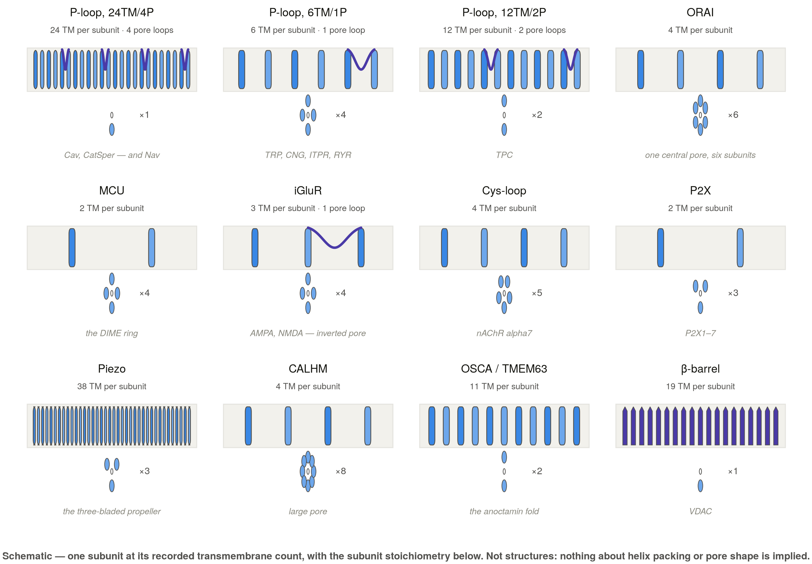
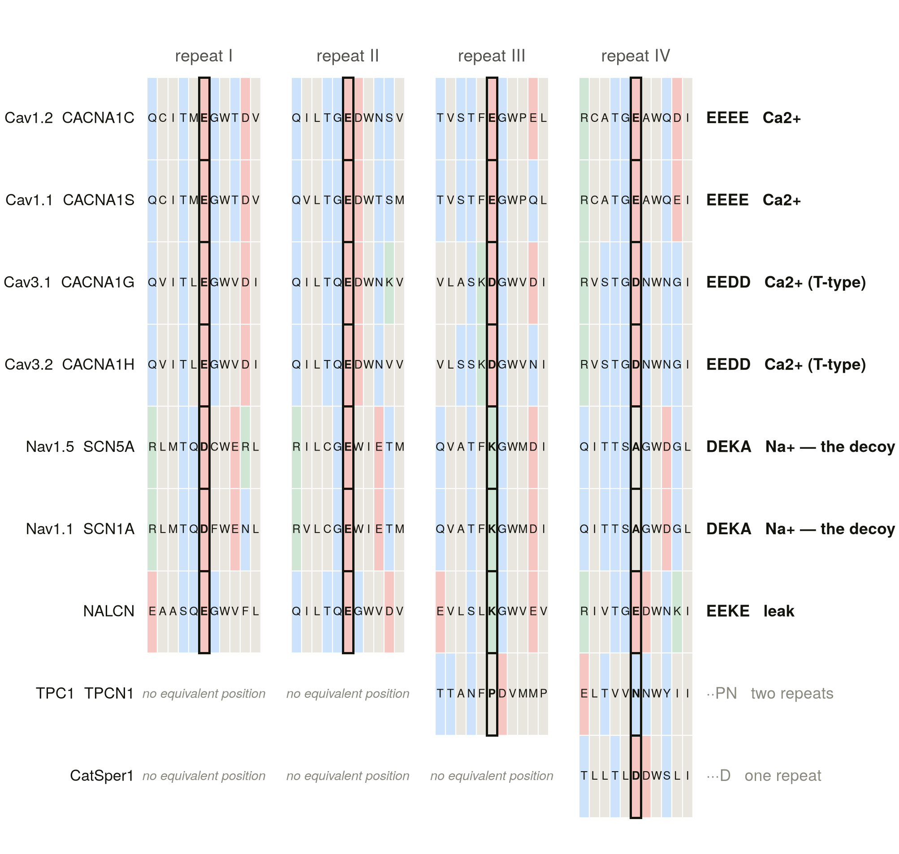
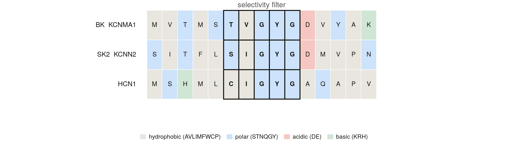
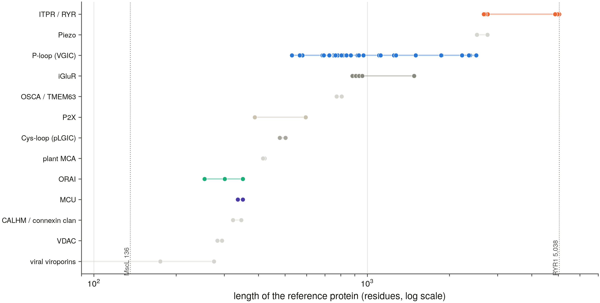
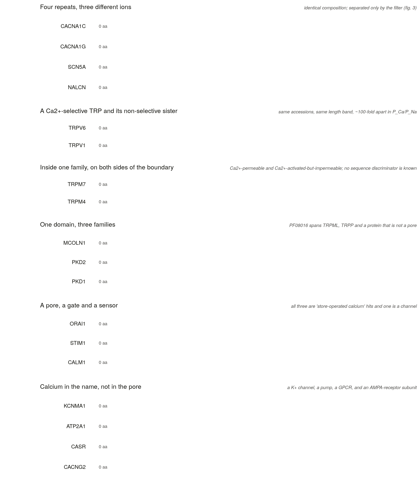
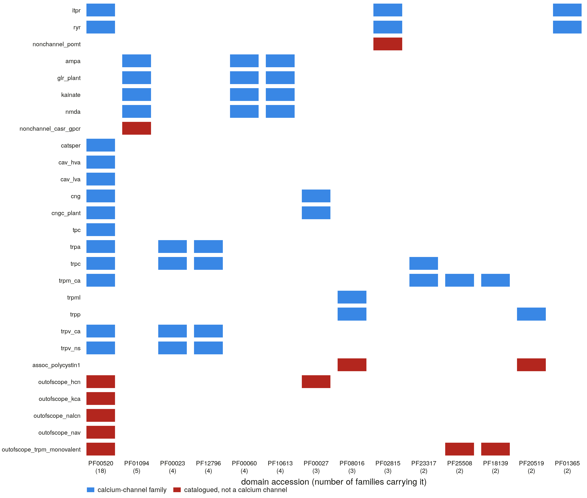
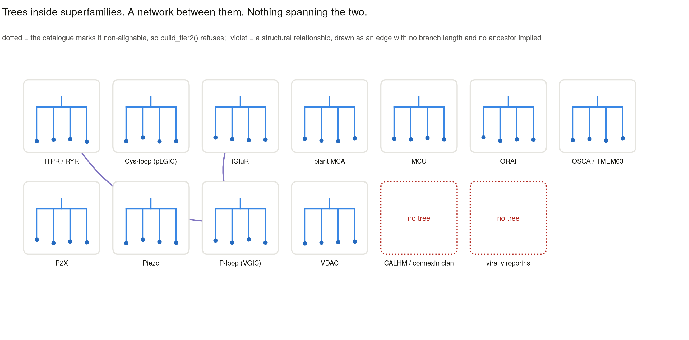

# The calcium channels: one permeability, many origins

*A review of the pathways that carry Ca²⁺ down its gradient through an open
pore — their filters, their folds, their evolution, and what the sequence
databases do and do not record about them.*

**Generated file — do not edit.** The text lives in `docs/review/*.md` and is
assembled by `scripts/s0_review_build.py`. Citations are written as stable
keys and renumbered on build; every reference was resolved against Europe PMC
by `scripts/s0_review_refs.py`, and a cited key with no verified record is a
build error rather than a silent entry in the bibliography.

---

## Summary

Calcium is the only ion whose channels are named for what they let through
rather than for what they are. Potassium channels can be defined
structurally: the T-x-G-Y-G filter is a sequence motif, and the proteins that
carry it are the proteins that conduct K⁺. Sodium channels are nearly as
clean. **A calcium census has no such handle.** "Calcium channel" names a
permeability ratio — a quantity measured in a particular cell, at a
particular divalent concentration, sometimes per subunit combination, and in
one important case per RNA-editing state of a single codon.

This review is organised around that fact and its consequences. The pores
that conduct Ca²⁺ have arisen independently in a large number of unrelated
folds, so there is no alignment containing a ryanodine receptor and an ORAI
channel and therefore no tree of calcium channels. What there is instead is a
set of independent inventions that converged on the same physical problem:
how to select a divalent ion that is thirty thousand times less abundant than
sodium in the cytosol's own gradient, and still conduct it at a rate near
diffusion.

We take the solutions one at a time — the four-repeat voltage-gated pore, the
CRAC channel's single glutamate ring, the uniporter's five-residue filter,
the epithelial TRPV aspartates, the intracellular release channels, the
ligand-gated receptors, the mechanosensors, and the plant, fungal and viral
channels that are not the animal ones renamed — and ask of each what is
genuinely shared and what merely looks shared.

Two questions then have to be answered before anything can be counted. The
first is where the boundary of the subject falls, because the word "calcium"
attaches to Ca²⁺-*activated* channels that conduct K⁺ or Cl⁻, to pumps and
exchangers that are not channels, to EF-hand sensors that conduct nothing,
and to sixteen human genes whose symbols begin `CACN` and which encode no
pore at all. The second is what the annotation databases actually record,
which turns out to be less than a census needs and to fail in ways that are
systematic rather than random.

## Scope, and what "the census" means here

Every count in this review is a count under the boundary decisions recorded
in `docs/scope_and_boundaries.md`, and is reported in tiers rather than as a
single headline number. The catalogue behind it holds **245 human genes and
counts 98**: 28 in the selective tier, 50 permeable, 9 conditional and 11
release. The 147 it does not count are catalogued too, each with a recorded
reason and, wherever a test exists, a positive test identifying it as
something else. That ratio is the point. A review that listed only what it
counted would look tidier and would be impossible to check.

## Figures

| | |
|---|---|
| **1** | the folds that build a calcium-permeable pore, one subunit each — *schematic* |
| **2** | the potassium filter across the P-loop branch — *measured, no alignment used* |
| **3** | the four-repeat locus: EEEE / EEDD / DEKA / EEKE — *measured, projected from Nav1.5* |
| **4** | length range by superfamily — *measured* |
| **5** | which families carry which shared domain, and which cross the census boundary — *measured* |
| **6** | a rooted ML tree of the intracellular release channels — *not yet rendered; awaits the pore-module extraction of S6 and the tier-2 build of S8* |
| **7** | the forest, and the superfamilies that get no tree — *schematic of a rule* |
| **8** | the architecture traps, to scale — *measured* |

Seven of the eight are rendered; figures rendered from committed tables
carry the table they came from in their legend, and the schematics say so and
display no data beyond the counts in them. **Figure 6 is deliberately
absent.** A tier-2 tree requires the pore module to be extracted first,
because a full-length alignment of a 5,038-residue ryanodine receptor against
a 2,700-residue IP₃ receptor is dominated by the cytoplasmic caps rather than
by the pore. Running the command on full-length sequences produces a tree,
and the tooling itself reports that the result is a quick look rather than
the tier-2 result. Substituting it here would be the kind of quiet
methodological downgrade this project forbids, so the figure waits for S6 and
S8.

## Key points

- **Calcium-channel membership is a permeability, not a clade.** There is no
  motif and no fold that defines the subject, so the census is reported in
  four evidence tiers and a flat total is never quoted without them.
- **The nearest relative of a calcium channel is usually not one.** Cav sits
  beside Nav and is separated from it by four residues; CNG beside HCN;
  TRPV6 beside TRPV1; TRPM7 beside TRPM4. Domain architecture cannot make
  any of these calls.
- **Ca²⁺ selectivity has been invented repeatedly in unrelated folds.** The
  four best-characterised solutions — the EEEE ring, ORAI's E106, the
  uniporter's DIME motif and the TRPV aspartate ring — share no alignable
  position with one another.
- **Some permeabilities are not in the genome.** Whether an AMPA receptor
  conducts Ca²⁺ is decided by ADAR2 editing of a single GRIA2 codon, and no
  sequence-level method can recover it.
- **The word "calcium" is the census's largest error source.** The
  Ca²⁺-activated channels conduct K⁺ or Cl⁻; the pumps and exchangers are
  transporters; the EF-hand sensors conduct nothing; and of the sixteen
  `CACN`-prefixed human genes that encode no pore, seven belong to the AMPA
  receptor.
- **Domain annotation does not partition the subject the way the textbooks
  do**, and a census built on the obvious accessions loses whole divisions
  without saying so.

## 1. Why calcium, and why it is hard to count

### 1.1 An ion chosen for its scarcity

Calcium signalling begins with an accident of chemistry that life turned into
an advantage. Ringer found in 1883 that a frog heart would not keep beating
in saline made without calcium, and that restoring it restored contraction
[1]. Seventy years later Fatt and Katz recorded, in crustacean
muscle, an action potential that persisted when sodium was removed and that
was carried instead by calcium — the first evidence of a voltage-gated
calcium conductance [2]. The two observations bracket what makes the
ion useful: it is required, and it is separately controllable.

The reason is a gradient maintained at metabolic cost. Cytosolic free Ca²⁺
rests near 100 nM against roughly 2 mM outside and 0.3–0.8 mM in the
endoplasmic reticulum, a ratio of about ten thousand to one — steeper than
any other physiological ion gradient. A cell that opens a calcium-permeable
pore therefore gets a large, fast, local signal from a very small number of
ions, and one that can be terminated by buffering and pumping rather than by
bulk transport. Calcium is a second messenger because it is scarce, and the
machinery that keeps it scarce is what makes the message legible
[3,4,5,6].

The techniques that made these currents legible were developed on other ions
and inherited. The Hodgkin–Huxley description of the squid axon established
that a membrane current could be decomposed into independent, voltage-
dependent conductances and modelled quantitatively before any channel protein
was known [7], and single-channel recording made the discrete
conducting unit directly visible [8]. Both were applied to calcium
currents almost immediately, and the vocabulary of this review — selectivity
ratios, activation thresholds, single-channel conductance — is theirs.

That scarcity sets the engineering problem the rest of this review is about.
A calcium-selective pore must discriminate Ca²⁺ from Na⁺ and K⁺ that are
present at a hundred to a thousand times its concentration, and must do so
while conducting at rates approaching free diffusion. High selectivity
normally means tight binding, and tight binding normally means slow release.
The resolution — a pore that binds calcium tightly enough to exclude
monovalents but holds more than one ion at a time, so that electrostatic
repulsion between them restores a high throughput rate — was worked out for
the L-type channel and remains the general principle
[9,10]. Nearly every solution described below is a variation
on it.

### 1.2 A functional class, not a clade

The term "calcium channel" was never a phylogenetic claim. It describes
behaviour, and the behaviour has been arrived at many times. This review's
catalogue places the pore-forming calcium channels in **17 superfamilies**,
several of which share no alignable position with any other: the P-loop
channels, the TRP division, the intracellular release channels, ORAI, the
mitochondrial uniporter, VDAC, the Cys-loop receptors, the ionotropic
glutamate receptors, P2X, Piezo, the OSCA/TMEM63 mechanosensors, the CALHM
large pores and the viral viroporins, among others.

This has a consequence that organises the entire project behind this review:
**there is no tree of calcium channels.** An alignment column that contains a
residue of a ryanodine receptor and a residue of ORAI1 does not exist, and a
tree built across them would be a picture of an alignment artefact. What can
be built is a *forest* — trees within families and within superfamilies,
where descent is real — plus a structural network between the folds, which
carries no branch lengths and no support values because it is not a
phylogeny. Any sentence beginning "calcium channels evolved…" is therefore
either about one superfamily or is wrong.

Three long-standing observations make the same point from the other
direction, and each is a place where the obvious grouping misleads:

- **Cav and Nav are the same architecture.** Both are single polypeptides of
  four homologous six-transmembrane repeats surrounding one pore. They are
  separated by the four residues that each repeat contributes to the
  selectivity filter — EEEE in Cav1/Cav2 against DEKA in Nav — and a single
  substitution in the sodium channel confers calcium selectivity on it
  [11].
- **Calcium permeability varies within families.** TRPV5 and TRPV6 are
  Ca²⁺-selective and their close relatives TRPV1–TRPV4 are not; the nicotinic
  α7 subunit reaches P_Ca/P_Na near 10 while its sister α4 is near 1
  [12,13].
- **Calcium permeability is sometimes not encoded at all.** An AMPA receptor
  containing an edited GluA2 subunit is calcium-impermeable; the same gene,
  unedited, is not. The decision is made post-transcriptionally by ADAR2 on a
  single codon [14,15].

### 1.3 A definition, and its five edges

Throughout this review a calcium channel is:

> a protein assembly forming a **gated aqueous pore** that conducts Ca²⁺
> across a membrane **down its electrochemical gradient**, without a coupled
> conformational transport cycle.

Each clause marks a boundary that published gene lists draw differently, and
each is worth stating because the disagreements account for most of the
variation between counts.

1. **Selectivity is not required, but it is graded.** Demanding
   P_Ca/P_Na > 10 would exclude most TRP channels, every Ca²⁺-permeable AMPA
   receptor, P2X, Piezo and CNG — that is, most of the calcium entry in most
   non-excitable cells. Admitting anything with a measurable Ca²⁺ current
   would admit the muscle nicotinic receptor and, in the limit, any large
   pore. This review therefore reports four tiers with the evidence for each
   attached, and never a single number.
2. **Gating *by* calcium is not membership.** BK and SK channels, TMEM16A and
   TRPM4/TRPM5 are opened by cytosolic Ca²⁺ and conduct K⁺, Cl⁻ or
   monovalent cations [16,17]. They carry "calcium" in
   their names and in most review titles, and they are the single most common
   contaminant of keyword-built lists.
3. **Transport is not conduction.** SERCA, PMCA and SPCA hydrolyse ATP; NCX,
   NCKX and NCLX are coupled to the sodium gradient
   [18,19,20]. They move more calcium per cell
   than most channels do, and they are excluded on mechanism, not importance.
4. **Auxiliary subunits are not pores.** The Cav β, α2δ and γ subunits, STIM1
   and EMRE are each required for a calcium channel to work and none of them
   lines a pore [21]. They are the largest single source of
   inflation in published totals.
5. **Release from a store counts, and is recorded as such.** IP₃ receptors,
   ryanodine receptors, TRPML and the two-pore channels do not admit calcium
   to the cell; they move it from an internal store into the cytosol, which
   is often the larger signal [22,23].

### 1.4 What follows

Sections 2–10 take the pores themselves: first the selectivity filters,
because they are what the census ultimately turns on, then the families
grouped by where their calcium comes from — the plasma membrane, the internal
stores, the mitochondrion — and by what opens them. Section 11 works through
the boundary explicitly, and is where the excluded set is argued rather than
assumed. Section 12 reports what the annotation databases record, measured
against live services rather than recalled. Sections 13–15 turn to evolution,
disease and what remains unresolved, and section 16 states the methods.

## 2. Four filters, no common ancestor

If calcium channels formed a clade, they would share a filter. They do not.
The four best-characterised calcium-selective pores are built from four
different structural ideas, occupy four unrelated folds, and share no
alignable position with one another. This section takes them in turn, because
everything the census does downstream — the positive tests, the hazard rules,
the refusal to build one tree — follows from the fact that they are separate
inventions.

**Figure 1 | The folds that build a calcium-permeable pore.** One subunit
each, drawn to a common scheme, for the folds represented in this review's
catalogue. Transmembrane helices are boxes and pore-forming re-entrant loops
are marked; the drawing is schematic and carries no data beyond the topology
and the counts shown. The point of the figure is the absence of a common
ancestor: no two of these can be aligned to one another, and the calcium
selectivity of each was arrived at independently.

### 2.1 The EEEE ring: four repeats, four glutamates

The voltage-gated calcium channel is a single polypeptide of four homologous
repeats, each contributing one re-entrant P-loop to a single central pore.
Mutagenesis of the L-type channel identified one glutamate per repeat as the
determinant of calcium selectivity, and neutralising them degrades
selectivity in proportion to the number changed: the filter is a ring of four
carboxylates, and it acts as a unit [10]. The complementary experiment
is the more striking one. Substituting the corresponding residues of a sodium
channel — whose own ring reads DEKA — converts it into a calcium-selective
channel [11]. Four side chains separate the two largest families
of voltage-gated cation channels in the human genome.

Structures later showed why the ring can be both selective and fast. The
bacterial channel CavAb, engineered from a sodium-channel scaffold, and the
rabbit Cav1.1 complex both resolve multiple Ca²⁺ ions bound in file within
the filter [24,25,26]. Selectivity comes from a
high-affinity site that monovalents cannot compete for; throughput comes from
a second ion arriving and repelling the first. Tight binding and fast
conduction are reconciled by never having only one ion present.

The same locus separates four families that domain architecture cannot tell
apart at all, and this review's project reads it as a four-residue string
projected from human Nav1.5:

| filter | family | note |
|---|---|---|
| EEEE | Cav1, Cav2 | the high-voltage-activated locus |
| EEDD | Cav3 | the T-type locus |
| DEKA | Nav | a sodium channel |
| EEKE | NALCN | a sodium-leak channel [27] |

**Figure 3 | Four residues separate two superfamilies.** The four-repeat
selectivity locus, projected from human Nav1.5 `Q14524` onto each query by
alignment and read directly — rendered from `filter_four_repeat.tsv`. The
high-voltage-activated calcium channels read EEEE, the T-type channels EEDD,
the sodium channels DEKA and NALCN EEKE. Two rows carry the caution rather
than the result: TPC1 returns a partial signature because it has two repeats
rather than four, and CatSper1 returns a partial signature because its four
positions lie in four different proteins. A partial result is recorded as
partial, not discarded.

Cav3's EEDD is the reason the census cannot use "EEEE" as its test: the
T-type channels are calcium channels with a different ring
[28,29]. CatSper, the sperm channel, shares the same
architecture again and cannot be read this way at all, because its four
pore-forming subunits are four separate genes contributing one residue each
[30,31].

### 2.2 ORAI: one glutamate, and a pore that is not a P-loop

The store-operated calcium current is the most calcium-selective conductance
in the plasma membrane, with P_Ca/P_Na above 1000, and it is carried by a
protein with no relationship to any voltage-gated channel. ORAI1 has four
transmembrane helices, no P-loop, and assembles as a hexamer; its filter is a
single glutamate, E106, contributed once per subunit
[32,33,34,35]. The *Drosophila* Orai
structure showed the ring directly, at the extracellular mouth of a long
pore lined by basic residues [36]. Mutating E106 to glutamine abolishes
calcium selectivity outright.

Structurally this is the same trick as the EEEE ring — a ring of
carboxylates at the narrowest point — implemented in a fold that has nothing
in common with the P-loop channels. It is the clearest single case of
convergence in the subject.

### 2.3 The uniporter: the shortest filter, the highest selectivity

Mitochondrial calcium uptake was measured as a current in 2004 and shown to
be the most calcium-selective channel then known, with an estimated
P_Ca/P_Na above 10⁴ [37]. The protein responsible was not
identified for another seven years, by two groups in the same year, using
comparative genomics built on the observation that yeast takes up no
mitochondrial calcium and lacks the gene
[38,39,40].

MCU's filter is a five-residue motif, W-D-x-x-E, known as DIME and sitting in
a short loop between two transmembrane helices. Cryo-EM structures of fungal
and metazoan uniporters resolve the two acidic rings it forms
[41]. It is the only family in this review's catalogue that can be
called from a bare regular expression on an unannotated sequence, and it
achieves the highest selectivity of any of them with the smallest filter.

The uniporter also supplies the subject's cleanest boundary case. EMRE is
required for conduction in metazoans and lines none of the pore
[42]; MICU1 is an EF-hand gatekeeper that holds the channel shut at
resting calcium [40]. Both are excluded from the census. MCUB, by
contrast, assembles into the tetramer, contributes pore lining, and *reduces*
conduction — and is counted, because the question the catalogue asks is
whether a gene contributes pore lining, not whether it increases current.

### 2.4 The TRPV aspartate ring, and an anchor that had moved

TRPV5 and TRPV6 are the epithelial calcium channels of intestinal and renal
reabsorption, with P_Ca/P_Na above 100 [43,44,45]. Their close relatives TRPV1–TRPV4 are non-selective cation
channels. The discriminator is a ring of one aspartate per subunit in the
outer pore, resolved in the TRPV6 structure [46].

This filter is the one that cannot be found by pattern, because the residue
sits in no conserved context; it has to be projected from a reference
sequence. Doing so exposed a trap worth recording, because it is the kind
that fails silently. The literature numbers the TRPV6 aspartate D542. The
canonical human UniProt entry `Q9H1D0` is the 765-residue long isoform and
carries the filter `TIIDGP` at positions 579–584, putting the aspartate at
**D582** — a 40-residue offset. An anchor taken from a paper's numbering
would have aligned correctly, projected the wrong column, and returned a
confident answer about the wrong residue. Every projection anchor in this
project is therefore verified against its own reference before use, and a
non-validating anchor refuses to project rather than guessing. All three
anchors were re-verified against live UniProt on 2026-08-20: Nav1.5
`Q14524` reads DEKA at 372/898/1419/1711, ORAI1 `Q96D31` reads E at 106, and
TRPV6 reads D at 582.

A caution belongs with this one. TRPV1–TRPV4 also carry acidic residues in
the outer pore, so a projected aspartate is supporting evidence rather than a
family call, and how far the anchor actually separates the two groups is a
measurement the classifier benchmark makes rather than an assumption
(*pending: S1*).

### 2.5 The negative test used positively

One motif does more work in a calcium census than any of the above: the
potassium filter, T-x-G-Y-G. A protein carrying it conducts K⁺, which settles
the Ca²⁺-*activated* potassium channels — BK, SK — without consulting a name,
a symbol or an annotation. In a subject where the most common error is
admitting something because it has "calcium" in its title, a reference-free
regular expression that says "this conducts potassium" is the most reliable
exclusion available.

**Figure 2 | The exclusion that needs no reference.** The T-x-G-Y-G
potassium filter located directly in each sequence with flanking context —
no alignment was performed — rendered from `filter_k.tsv`. In a calcium
census this is a negative test used positively: a protein carrying it
conducts K⁺, which removes the Ca²⁺-activated potassium channels from the
count without consulting a name, a symbol or an annotation.

The limits are equally worth stating. TRPM4 and TRPM5 are Ca²⁺-activated and
conduct monovalent cations rather than K⁺, so no potassium filter identifies
them; they share every Pfam accession and the same length band with the
Ca²⁺-permeable TRPMs, and nothing in their sequence separates them. That
split is a literature call, recorded as one, and the classifier is not
expected to make it.

## 3. The voltage-gated calcium channels

### 3.1 Ten genes, three subfamilies, one architecture

The voltage-gated calcium channels are the family the term "calcium channel"
usually means, and the one whose pharmacology reaches furthest into clinical
practice. Ten human α₁ genes encode the pore, and they fall into three
subfamilies by sequence and by physiology [47,48]:

| subfamily | genes | current | activation |
|---|---|---|---|
| Cav1 | `CACNA1S`, `CACNA1C`, `CACNA1D`, `CACNA1F` | L-type | high-voltage |
| Cav2 | `CACNA1A`, `CACNA1B`, `CACNA1E` | P/Q-, N-, R-type | high-voltage |
| Cav3 | `CACNA1G`, `CACNA1H`, `CACNA1I` | T-type | low-voltage |

The purification that started the molecular era used the dihydropyridine
receptor of skeletal muscle, and the sequence that followed established the
four-repeat architecture [49]; the cardiac L-type channel followed
[50], and the T-type channels last, a decade later
[28,29]. Structures of the Cav1.1 complex resolved the
pore, the four voltage sensors and the auxiliary subunits together
[25,26].

Physiologically the split that matters is not Cav1 against Cav2 but
high-voltage against low-voltage. Cav1 and Cav2 open on strong
depolarisation and carry the calcium that triggers contraction and
transmitter release; Cav3 opens near rest, inactivates quickly, and supports
rhythmic firing and rebound bursts [28]. Cav1.1 in skeletal
muscle is the extreme case: it works largely as a voltage sensor
mechanically coupled to RyR1 rather than as a conduit, and calcium entry
through it is not what triggers contraction [51].

### 3.2 The nearest relative is a sodium channel

Cav's closest architectural neighbours are not other calcium channels. The
four-repeat P-loop channels comprise the voltage-gated calcium channels, the
voltage-gated sodium channels, the sodium-leak channel NALCN and the sperm
channel CatSper, and they are indistinguishable by domain architecture
[27,52,53]. This project's own measurement makes
the point concretely: `PF00520` in four copies describes all of them equally
well, and CACNA1G carries `PF00520`×4 and nothing else — no Cav-specific
domain at all.

The consequence for any census is direct. A calcium channel here cannot be
recognised by what domains it carries; it has to be recognised by reading the
filter (§2.1). This is the single most important hazard in the subject, and
the reason the classification behind this review assigns by positive test
rather than by architecture.

A second, subtler consequence concerns trees. Because superfamilies are
defined by descent rather than by ion, a pore-module tree of the P-loop
superfamily *contains* the sodium channels and the Ca²⁺-activated potassium
channels. Dropping them to produce "the calcium channel tree" would hide the
non-monophyly and remove the outgroup that makes the tree rootable. The
protocol behind this review forbids it.

### 3.3 The subunits that are not channels

The high-voltage-activated channels are complexes: an α₁ pore with a
cytoplasmic β subunit, an extracellular-facing α2δ and, in some tissues, a γ
subunit [21,54]. None of them forms a pore, and all of
them carry `CACN` symbols. Sixteen human genes do — four `CACNB`, four
`CACNA2D`, eight `CACNG` — and this review's catalogue counts none of them.

Three facts make this more than nomenclature:

- **The β subunit is required for the channel to reach the membrane at all**,
  and shifts its voltage dependence by tens of millivolts. It is a MAGUK — a
  scaffold fold doing a channel job.
- **α2δ-1 is the gabapentin and pregabalin target.** An auxiliary subunit
  that conducts nothing is among the most-prescribed drug targets in the
  entire catalogue [55,56].
- **Seven of the eight `CACNG` genes are not calcium-channel subunits at
  all.** CACNG2–CACNG8 are TARPs: claudin-fold proteins that traffic and
  modulate AMPA receptors, with no role in voltage-gated calcium channels.
  Their symbols are a historical accident of the order of discovery, and they
  are counted as calcium-channel genes by any list built on symbol prefixes.

This project measured the architectures directly and found that the three
subunit types share no domain at all: `CACNB1` carries a guanylate-kinase
domain and a β-specific N-terminal domain, `CACNA2D1` a von Willebrand A
domain and the α2δ domain, `CACNG2` a claudin domain alone. The "family" is
three unrelated protein types grouped by the job they do.

### 3.4 CatSper, and a filter that cannot be read

CatSper is the principal calcium channel of sperm, required for
hyperactivated motility and for male fertility, and gated in human sperm by
progesterone acting through a lipid hydrolase rather than through a classical
receptor [30,57,58]. It is a four-repeat channel
built the hard way: four distinct pore-forming genes, `CATSPER1`–`CATSPER4`,
each contributing one repeat, alongside several accessory subunits
[31].

That construction defeats the test that works for every other four-repeat
family. A filter projection reads four positions from one sequence; CatSper's
four positions are in four different proteins, so no single-sequence
projection can recover the ring. The locus is recorded as unread rather than
guessed, and closing it would need a joint projection across all four
subunits (*pending: S9*).

## 4. Release from internal stores

Calcium entering from outside is only part of the signal, and often the
smaller part. The endoplasmic and sarcoplasmic reticulum hold free Ca²⁺ at
0.3–0.8 mM against a cytosol at 100 nM, and the channels that open onto that
gradient produce most of the calcium transients in most cells. They are
counted here in their own tier, with the compartment recorded, because the
same permeability ratio means something different on an organelle: what
matters is not how well IP₃R discriminates Ca²⁺ from K⁺ but the size of the
gradient it opens onto.

### 4.1 IP₃ receptors and ryanodine receptors

The two large release channels are the largest proteins in this review's
catalogue — RYR1 is 5,038 residues — and they are relatives. Both were cloned
in 1989: the ryanodine receptor from skeletal muscle
[59] and the IP₃ receptor as the cerebellar P400 protein
[60], with the similarity between them noticed immediately
[61]. Both are homotetramers with a small C-terminal pore module of
the P-loop kind and an enormous cytoplasmic cap that acts as a
signal-integration platform, resolved by cryo-EM in both families
[62,63,64].

Their physiology is organised by what opens them. IP₃ receptors are gated by
IP₃ produced downstream of phospholipase C, with cytosolic Ca²⁺ as a
co-agonist, giving the biphasic dependence that underlies calcium waves and
oscillations [22]. Ryanodine receptors are gated by calcium itself
— calcium-induced calcium release, demonstrated in skinned cardiac fibres
long before the protein was known [23] — except in skeletal muscle,
where RyR1 is opened by direct mechanical coupling to Cav1.1 [51,65].

For a census, the pair are a domain-sharing hazard rather than a
discrimination problem: they share all four of `PF08709`, `PF01365`,
`PF08454` and `PF02815`, so architecture places a sequence in the pair
reliably and inside it not at all. One of those domains, the MIR domain
`PF02815`, is also carried by the O-mannosyltransferase POMT1, which is not a
channel — an illustration of why a domain hit is evidence about a superfamily
and not about a function.

### 4.2 Two-pore channels: counted, and contested

TPC1 and TPC2 sit in endosomal and lysosomal membranes and are structurally
the intermediate the four-repeat story predicts: two six-transmembrane
repeats rather than four, a plausible waypoint between a 6TM ancestor and the
duplicated Cav/Nav architecture.

Their permeability is genuinely disputed. They were identified as the NAADP
target releasing calcium from acidic stores [66], and direct
endolysosomal patch clamp subsequently found a PI(3,5)P₂-activated,
Na⁺-selective current instead [67]. This review counts them, in the
release tier, and records the dispute rather than resolving it by omission;
removing them costs the census two genes, and the catalogue is built so that
this is a one-line change and a recount.

### 4.3 TRPML and the lysosome

The mucolipins TRPML1–3 (`MCOLN1`–`MCOLN3`) are the lysosome's own release
channels, and TRPML1 loss causes mucolipidosis type IV. Their selectivity is
measured at lysosomal pH, near 4.6, which is part of why their reported
P_Ca/P_Na spans a wide range, and TRPML1 conducts Fe²⁺ as well
[68,69]. They belong to the TRP division by descent (§7) and are
placed in the release tier by compartment.

### 4.4 The regulators that are not channels

Around both large release channels sits a set of proteins that are required
for release and conduct nothing, and they are a good test of whether a gene
list is counting pores or counting participants. Calsequestrin is a luminal
calcium buffer whose occupancy sets how much RyR2 releases, and `CASQ2`
mutations cause catecholaminergic polymorphic ventricular tachycardia — the
same disease as `RYR2` mutations. FKBP12 and FKBP12.6 are immunophilins bound
to every RyR subunit. Triadin and junctin link the two.

The catalogue records these as channel-associated, and this project's own
architecture measurement found that they share no domain with one another:
`CASQ2` carries the calsequestrin domain alone, `FKBP1A` the FKBP domain
alone. A buffer and an immunophilin have in common only the channel they
regulate. TRIC channels (`TMEM38A`, `TMEM38B`) belong to the same category
from the other direction: they are potassium channels that provide the
counter-current for calcium release [70], and `TMEM38B` mutations
cause a calcium-release disease through a potassium channel.

## 5. Store-operated entry: a gate in another organelle

Store-operated calcium entry is the mechanism by which emptying the ER
opens a channel in the plasma membrane, and it was a physiological
phenomenon for two decades before either of its two proteins was known. The
current — CRAC, calcium release-activated calcium — is tiny, inwardly
rectifying and extraordinarily selective, with P_Ca/P_Na above 1000
[71,72].

Its molecular basis arrived from two directions within about a year. RNAi
screens in *Drosophila* identified STIM as the ER sensor
[73,74], and then a genome-wide screen, a linkage study in a
patient with severe combined immunodeficiency, and a parallel screen
converged on ORAI1 as the pore
[34,35,75]. That the same gene came out of an
unbiased screen and a human immunodeficiency pedigree is a large part of why
the assignment was accepted quickly. Pore-mutation experiments then
established that ORAI1 is the channel rather than a regulator of one, by
showing that altering E106 alters the selectivity of the current itself
[32,33].

### 5.1 Why this family is architecturally isolated

ORAI has four transmembrane helices, no P-loop, no voltage sensor, and no
detectable homology to any other channel family in this review. The hexameric
*Drosophila* Orai structure showed a single long pore with the E106 ring at
its extracellular mouth [36]. In the catalogue it is one family in its
own superfamily and its own fold, and in the fold network it is one of the
clearest examples of a Ca²⁺-selective pore that owes nothing to the others.

For the census this makes ORAI easy in one respect and hard in another. It is
easy to test — a single projected glutamate, verified against live UniProt at
`Q96D31` position 106 — and impossible to place in any tree containing
another calcium channel.

### 5.2 STIM: required, and not a pore

STIM1 spans the ER membrane with a luminal EF-hand that senses store
depletion; on emptying it oligomerises, migrates to ER–plasma membrane
junctions and traps and opens ORAI directly. It is as necessary to the
current as ORAI is, and it conducts nothing. The catalogue records STIM1 and
STIM2 as channel-associated.

STIM also illustrates why an EF-hand cannot be used as evidence against
channel identity. This project's canonical EF-hand detector finds four loops
in calmodulin, four in calbindin, two in parvalbumin, two in MICU1 and one in
STIM1 — and zero in CACNA1C and zero in MCU. EF-hands mark the calcium
*sensors*, including two that sit inside census complexes as gatekeepers, and
none of the pores. The motif is a useful positive detector for the decoys and
never a veto.

## 6. The mitochondrial pathway

### 6.1 Fifty years between a current and a gene

Mitochondria take up calcium avidly, and the fact has been known since the
1960s. Direct patch clamp of the inner membrane finally measured the
conductance responsible and showed it to be a channel of extraordinary
selectivity, with an estimated P_Ca/P_Na above 10⁴ — greater than any
plasma-membrane calcium channel [37]. The gene took another seven
years.

The reason it took so long is instructive, and it is an evolutionary fact
rather than a technical one. *Saccharomyces cerevisiae* has no mitochondrial
calcium uptake, so the standard genetics of the era had no assay; and the
protein has no homology to any known channel family, so sequence-based
searching had no query. What eventually worked was comparative genomics
across organisms that do and do not take up mitochondrial calcium: MICU1 came
out of a phylogenetic-profiling screen [40], and MCU itself was
identified the next year by two groups
[38,39]. Structures followed [41].

MCU's filter is the `WDxxE` DIME motif (§2.3). The catalogue counts MCU and
MCUB — the latter a pore-lining subunit that reduces conduction — and
excludes MICU1–3, EMRE and MCUR1 as regulators [42].

### 6.2 VDAC, and a boundary this review draws loosely

The outer mitochondrial membrane is crossed by VDAC1–3, wide aqueous pores
that pass metabolites and are the route by which cytosolic calcium reaches
the intermembrane space and thus the uniporter
[76,77,78]. They are counted in the
permeable tier.

This is a genuinely arguable inclusion, and worth flagging as such. VDAC is
not a calcium channel in the sense Cav is: it is a β-barrel with a wide pore
and little discrimination, whose calcium permeability is a consequence of its
general permissiveness. It is counted because it is a real and physiologically
important transmembrane calcium route, and removing it costs the census three
genes. Its permeability is recorded as "not applicable — a wide aqueous pore"
rather than as a ratio, which is the honest form of the claim.

### 6.3 Efflux, which is not conduction

Calcium leaves the mitochondrion through NCLX, a sodium/calcium exchanger
[79], and LETM1 has been reported as a calcium/proton antiporter
[80]. Both are transporters and both are excluded on mechanism. LETM1
is worth naming because it sits in the catalogue's exchanger family by
function while carrying none of that family's domain: this project measured
its architecture directly and found the LETM1 domain and no
sodium/calcium-exchanger domain at all. The family groups proteins by the job
they do, and the annotation records that they are not relatives.

## 7. The TRP division: one superfamily, every answer

The TRP channels are where the difficulty of a calcium census is most
concentrated. They are a single superfamily by descent, they span the whole
range from Ca²⁺-selective to Ca²⁺-impermeable, and the boundary between those
states falls *inside* families rather than between them. The founding member
was found in a *Drosophila* phototransduction mutant, and the mammalian
division has grown to some 28 human genes across six families
[81,82]. They are also, as a group, heavily represented in
inherited disease, across a range of organ systems that reflects how widely
the division is deployed rather than any shared mechanism [83]. Their permeabilities were surveyed early and the
survey's conclusion has held: TRP selectivity is a spectrum, and it is not
predictable from family membership [12].

### 7.1 TRPV: a family split by one residue ring

TRPV1 is the capsaicin and heat receptor, the founding member of the
mammalian nociceptive TRPs and a non-selective cation channel
[84]. TRPV5 and TRPV6 are its close relatives and are
Ca²⁺-selective epithelial channels responsible for the apical step of
transcellular calcium reabsorption in kidney and intestine
[43,44,45,46].

This review's catalogue therefore splits TRPV into two families on measured
permeability rather than on sequence similarity — a selective pair and a
non-selective remainder — and records that they carry the same Pfam
accessions and occupy the same length band. The split is honest and
uncomfortable: it is a division of a natural sequence group by a functional
measurement, and the only positive test available for it is the projected
aspartate ring of §2.4, whose discriminating power is itself something to be
measured rather than assumed.

### 7.2 TRPM: Ca²⁺-permeable and Ca²⁺-activated in the same family

TRPM is the same problem again, and worse. TRPM2, TRPM3, TRPM6 and TRPM7 are
Ca²⁺-permeable; TRPM4 and TRPM5 are Ca²⁺-*activated* channels that conduct
monovalent cations and no calcium at all
[16,17]. TRPM6 and TRPM7 in fact prefer Mg²⁺ and Zn²⁺ to
Ca²⁺, and carry a fused α-kinase domain — a channel with an enzyme bolted on,
which is exactly what a one-domain-of-interest assumption misfiles.

The census excludes TRPM4 and TRPM5 and counts the rest. There is no sequence
test that makes this call: the potassium filter does not fire on them, they
share every Pfam accession with their Ca²⁺-permeable relatives, and they sit
in the same length band. The exclusion is a literature call, is recorded as
one, and is precisely the kind of boundary that a census must be able to
state it cannot derive.

### 7.3 The rest of the division

TRPC is the closest to the *Drosophila* founder and is the family most
dependent on assembly: TRPC1 behaves differently alone than in TRPC1/TRPC4 or
TRPC1/ORAI1 complexes, so its permeability is a property of the complex
rather than of the gene. TRPA1 is a single human gene and a chemical irritant
sensor. TRPML (§4.3) and TRPP are intracellular. PKD2 is the contested case:
established in the ER and the primary cilium, disputed in the plasma
membrane, and counted with the dispute recorded.

### 7.4 What the annotation does to this division

The TRP channels are the clearest demonstration in this review that domain
annotation does not partition the subject the way the textbooks do. Measured
against InterPro:

- `PF00520` (Ion_trans), the canonical P-loop pore model, is carried by
  TRPV1, TRPV5, TRPA1 and TRPM2 — and **not** by TRPC3, TRPM8, MCOLN1,
  MCOLN2 or PKD2. Their pores are modelled by `PF08344`, `PF18139` and
  `PF08016` instead. A census that enumerates P-loop channels by `PF00520`
  loses most of the TRP division without reporting a gap.
- `PF16519` (TRPM_tetra), a tetramerisation domain *named for* TRPM, is
  annotated on TRPM7 and is absent from TRPM2, TRPM8, TRPM4 and TRPM5
  (measured 2026-08-20). It is carried by a minority of the family it is
  named after.
- `PF08016` (PKD_channel) is carried by TRPML, TRPP **and** polycystin-1 —
  which forms no pore on its own.

None of these is a database error. They are what a set of models built from
the best-studied members of each family looks like when it is asked about the
members nobody studied, and they are the reason the census behind this review
runs profile-HMM and genomic sweeps in addition to domain enumeration
(*pending: S2, S3, S5*).

## 8. Ligand-gated calcium entry, and a permeability not in the genome

Three unrelated superfamilies of ligand-gated channels carry physiologically
important calcium currents: the ionotropic glutamate receptors, the Cys-loop
nicotinic receptors, and P2X. They have nothing in common structurally, and
each provides a different reason why calcium permeability resists
sequence-based prediction.

### 8.1 NMDA receptors: selective, and obligately heteromeric

NMDA receptors are the most calcium-permeable of the glutamate receptors,
with a fractional calcium current near 12 %, and their calcium entry is the
trigger for most forms of synaptic plasticity [85,86].
They are counted in the selective tier.

They also make the sharpest case for the census counting *genes* rather than
*channels*. Seven human `GRIN` genes encode NMDA receptor subunits and not
one of them makes a channel alone: the receptor is an obligate heterotetramer
of GluN1 with GluN2 or GluN3 subunits, and GluN3-containing receptors are far
less calcium-permeable than GluN2-containing ones. Counting genes is
reproducible; counting "channels" would require deciding which subunit
combinations exist in which cells, which is not a genomic question. The
census counts genes and says so.

### 8.2 AMPA and kainate receptors: the permeability ADAR2 decides

AMPA receptors are the clearest case in all of calcium biology of a
functional property that the genome does not encode. A receptor containing an
edited GluA2 subunit is calcium-impermeable; the same receptor without it is
calcium-permeable. The difference is a single codon in `GRIA2`, changing a
glutamine to an arginine in the pore-lining M2 loop, and the change is made
post-transcriptionally by the RNA editing enzyme ADAR2
[14,87,88].

The genetics are unambiguous about which state matters. Mice lacking ADAR2
die young with seizures, and the phenotype is rescued completely by a
knock-in allele encoding the edited residue directly — the enzyme's only
essential substrate, in that context, is that one codon [15].

For a sequence-based census this is a hard limit rather than a difficulty.
The genomic `GRIA2` sequence encodes the calcium-permeable form; editing is
close to complete in adult brain; and no method operating on genomes or
proteomes can recover the distinction. The catalogue therefore places AMPA
and kainate receptors in a **conditional** tier, records the mechanism, and
records that there is no test. A census that quoted a single number for
"calcium-permeable human genes" without that tier would be asserting
something about nine genes that nothing in the data supports.

### 8.3 Nicotinic receptors: a boundary that splits sisters

The Cys-loop nicotinic acetylcholine receptors span an order of magnitude in
calcium permeability. The α7 homopentamer reaches P_Ca/P_Na near 10 and
carries calcium entry sufficient to trigger downstream signalling; the
muscle-type receptor is near 0.1–1 [13]. The catalogue counts α7, α9
and α10 and excludes the rest.

This is the census's most uncomfortable boundary, and it is worth stating
plainly rather than smoothing over. It divides a single natural sequence
family by a measured ratio, placing sister subunits on opposite sides. If a
tree of the nicotinic subunits does not separate them, the split is honest
and awkward; if it does, it is a real clade. Which of those is true is a
result to be produced, not assumed (*pending: S7*).

### 8.4 P2X: a third fold, and a pore that changes size

P2X receptors are ATP-gated trimers with two transmembrane helices per
subunit and no relationship to either of the families above; the zebrafish
P2X4 structure established the fold [89,90]. The seven human
paralogues span roughly an order of magnitude in calcium permeability, with
P2X1 and P2X4 highest [91].

P2X7 adds a further complication of the kind that defeats any static
description: on prolonged activation its pore dilates and begins to pass
molecules up to about 900 Da. A permeability measured at one moment of
activation is not the permeability at another, which is one more reason the
catalogue stores these ratios as strings with their conditions attached
rather than as numbers.

## 9. Mechanically activated calcium entry

Mechanosensitivity has been invented many times, and three of its solutions
carry calcium in a way that puts them in this census. None is related to any
other, and none is related to the voltage-gated channels.

### 9.1 Piezo

PIEZO1 and PIEZO2 were identified in a screen for the mechanically activated
current of a neuroblastoma line and are the mechanotransducers of touch,
proprioception, vascular development and red-cell volume regulation
[92,93]. They are very large — over 2,500 residues — and
their structures show a three-bladed propeller whose curved arms deform the
membrane and are thought to gate the central pore by flattening
[94].

They are non-selective cation channels with a modest calcium preference, and
they are counted in the permeable tier. Architecturally they are isolated:
their own superfamily, their own fold, and no alignable relationship to
anything else counted here.

### 9.2 OSCA / TMEM63

The OSCA channels were found in *Arabidopsis* as the hyperosmolality-gated
calcium-permeable conductance, in a screen for plants that failed to raise
cytosolic calcium in response to osmotic stress [95]. Their animal
relatives are the TMEM63 proteins, and the family is now understood as a
widespread mechanosensitive channel class.

The catalogue counts the family and records an asymmetry in the evidence: the
plant OSCA1 is well characterised as calcium-permeable, while divalent
permeability in the mammalian TMEM63 proteins is less thoroughly measured.
Mechanosensitivity is not in doubt; the calcium claim is stronger on one side
of the family than the other, and the record says so.

### 9.3 Plant MCA

MCA1 and MCA2 are *Arabidopsis* plasma-membrane proteins required for
mechanically induced calcium influx in roots, identified by complementation
of a yeast mutant [96]. They are small, carry a PLAC8 domain, and
have no animal counterpart in this census. They are one of several
demonstrations in §10 that plant calcium entry does not run through plant
versions of animal channels.

## 10. Plants, fungi and viruses

A census restricted to human genes cannot make an evolutionary claim, and the
non-animal calcium channels are emphatically not the animal ones renamed.
Three facts organise this section, and each of them is a constraint on any
statement about how calcium signalling evolved
[97,98,99].

### 10.1 Plants have no Cav

There is no plant homologue of the voltage-gated calcium channel family. This
is not a gap in annotation; it is an absence, and plants nonetheless perform
voltage- and ligand-dependent calcium signalling through two families that
are relatives of animal channels doing other jobs:

- **The glutamate receptor-like channels (GLR)** are homologues of the
  animal ionotropic glutamate receptors. They carry the wound-induced,
  long-distance calcium signal that propagates from a damaged leaf to
  undamaged ones, and the *glr3.3 glr3.6* double mutant loses it
  [100,101]. Note the form of that evidence: it is genetic
  evidence for a pathway, not a measured permeability ratio, and the
  catalogue records which kind of evidence it has.
- **The cyclic-nucleotide-gated channels (CNGC)** are relatives of the animal
  CNG and HCN channels, and several members are individually characterised as
  calcium-permeable.

Plants also have a two-pore channel, TPC1, in the vacuolar membrane — the
slow vacuolar current, and one of the better-characterised plant calcium
conductances.

The GLR case is also a hazard, and this project records it as one. The plant
channels carry all three of the domains the animal iGluRs carry — measured
2026-08-20 on *Arabidopsis* GLR3.3 and GLR3.4 — so nothing in the domain
architecture distinguishes a plant glutamate receptor-like channel from an
animal AMPA, kainate or NMDA receptor. A domain-based census that assumed
otherwise would misassign them silently.

### 10.2 Fungi kept Cav and lost MCU

Fungi retain a voltage-gated calcium channel homologue, CCH1, and have lost
the mitochondrial uniporter. *Saccharomyces cerevisiae* accordingly performs
no mitochondrial calcium uptake — the fact that made the uniporter invisible
to yeast genetics for decades and that, inverted into a
phylogenetic-profiling screen, is what finally identified MICU1 and MCU
(§6.1) [38,40].

Whether that loss is a single event or several, and how it maps onto the
fungal tree, is a question for ancestral reconstruction across the lineage
panel rather than one this review can settle (*pending: S10*).

### 10.3 Algae, and the origin questions

The photosynthetic eukaryotes are where the origin questions are decided,
because they retain combinations that neither plants nor animals kept.
Surveys of calcium channel repertoires across algal genomes find a
distribution that does not match either the plant or the animal pattern, and
they are the reason the lineage panel behind this census extends well beyond
the standard model organisms [102].

### 10.4 Viral viroporins

Several viruses encode small membrane proteins that form calcium-permeable
pores, and they are counted here because they meet the definition and because
excluding them would be a decision about taxonomy rather than about
mechanism. Rotavirus NSP4 is the best case: a genuine ER calcium-release
channel, and the virus's enterotoxin. At roughly 175 residues it is the
smallest protein in this review's catalogue — against RYR1's 5,038, a
thirty-fold span within one census. The SARS-CoV-2 E and ORF3a proteins are
also catalogued here.

The viroporins are marked as a superfamily that cannot be aligned across, and
they are one of the cases where the project's phylogeny protocol refuses to
build a tree rather than producing one from an alignment that does not exist.

## 11. What the word "calcium" costs

The largest source of error in a calcium census is not a difficult
phylogenetic call. It is the word. "Calcium" attaches to proteins that are
gated by calcium, that pump calcium, that exchange calcium, that bind
calcium, that sense calcium, and that assemble with calcium channels — and to
almost none of these does it attach because they conduct calcium down a
gradient through a pore. This section works through the excluded set, because
in this project the excluded set is a deliverable rather than housekeeping:
the catalogue holds **245 human genes and counts 98**, and the 147 it does
not count are what a search for "calcium channel" returns.

### 11.1 Gated by calcium, conducting something else

The Ca²⁺-*activated* channels are the most-cited contaminant.

| family | genes | conducts |
|---|---|---|
| BK | `KCNMA1` | K⁺ |
| SK / IK | `KCNN1`–`KCNN4` | K⁺ |
| TMEM16A/B | `ANO1`, `ANO2` | Cl⁻ |
| TRPM4/5 | `TRPM4`, `TRPM5` | monovalent cations |

They are opened by cytosolic calcium and they carry no calcium current. They
appear in IUPHAR class names, in review titles and in gene-set annotations
with "calcium" in them, and a keyword-driven list counts every one.

For the potassium channels a positive test exists and is decisive: the
T-x-G-Y-G filter says the protein conducts K⁺, without reference to a name or
a symbol. For TRPM4 and TRPM5 no such test exists (§7.2), and the exclusion is
recorded as a literature call.

### 11.2 Transporters

Nineteen human genes move calcium across membranes by mechanisms that are not
conduction:

- **P-type ATPases** — SERCA (`ATP2A1`–`ATP2A3`), PMCA (`ATP2B1`–`ATP2B4`)
  and SPCA (`ATP2C1`, `ATP2C2`) — hydrolyse ATP and move calcium against its
  gradient through an alternating-access cycle. SERCA is among the
  best-characterised membrane proteins in structural biology
  [18,19].
- **Na⁺/Ca²⁺ exchangers** — NCX (`SLC8A1`–`SLC8A3`), NCKX (`SLC24A1`–
  `SLC24A5`) and NCLX (`SLC8B1`) — couple calcium movement to the sodium
  gradient [20,79].

These are excluded on mechanism, not on importance; several move more calcium
per cell than most census families do. The distinction being drawn is between
a pore that is open at both ends at once and a cycle that is not.

### 11.3 Sensors and buffers, which conduct nothing

Calmodulin, calbindin, parvalbumin, the S100 proteins and the calcium-sensing
receptor CASR all bind or sense calcium and none conducts it
[103,104]. They are catalogued as non-channel homologues, and
they matter to a census for a specific reason: they are what an EF-hand-driven
or annotation-driven search returns.

The positive test here is the EF-hand itself, used as a *detector of decoys*
rather than as a veto (§5.2).

### 11.4 The subunits

Forty human genes encode proteins that assemble with calcium channels and
form no pore: the Cav β, α2δ and γ subunits, the CatSper accessories, STIM1
and STIM2, the uniporter regulators MICU1–3, EMRE and MCUR1, the release
regulators calsequestrin, FKBP12/12.6, triadin and junctin, and polycystin-1.

Sixteen of them carry a `CACN` symbol prefix, and seven of those sixteen —
CACNG2 to CACNG8 — are AMPA receptor subunits with no role in voltage-gated
calcium channels at all (§3.3). Any census assembled from symbol prefixes
counts all sixteen, and any census assembled from protein-complex membership
counts all forty.

### 11.5 The rule, and why it is a rule

Across every case above, the catalogue's requirement is the same: **a family
is excluded by a positive test, never by a caveat and never by a symbol.**
Not "this is not a Cav because the symbol says `SCN5A`", but "the filter
reads DEKA". Not "TRPM4 is probably not in scope", but either a test or an
explicit statement that no test exists and the call is a literature one.

The reason is that a census whose exclusions are unexamined is
unfalsifiable. Listing 98 genes and moving on would look tidier and would
give a reader nothing to check. Listing 245 with a recorded reason for each of
the 147 exclusions makes every one of them arguable — and each is designed to
be reversible by editing a single field and recounting. Moving the connexin
hemichannels into scope adds 16 genes; removing TPC costs 2; removing VDAC
costs 3; tightening the nicotinic boundary costs 3; dropping the conditional
tier entirely costs 9.

## 12. What the databases record

Everything in this section was measured against live services rather than
recalled, by `scripts/s0_catalogue_verify.py`, `scripts/s0_rule_coverage.py`
and `scripts/s0_anchors.py`, and is committed as tables under
`results/s0_baseline/`. The purpose is not to criticise the resources — they
are the reason a census is possible at all
[105,106,107] — but to establish what a census
built on them can and cannot claim.

### 12.1 The catalogue's own claims, re-derived

The catalogue is a file full of assertions: this Pfam accession exists and
means that; this gene symbol resolves to that protein in that organism; this
family's members carry these domains; this taxon id is that species. Written
by hand and checked by nothing, such a file is a liability. Re-deriving all of
it against live databases produced the following state:

| checked | n | result |
|---|---|---|
| Pfam accessions | 87 | all resolve; every short name matches |
| exemplar proteins | 102 | all resolve to a declared accession |
| taxon ids | 53 | all resolve |
| projection anchors | 3 | all read what the catalogue claims |
| declared architectures | 102 | 30 show an absence, all subfamily-level |

That table is the end state, and it is worth being explicit that it was not
the starting one. The verification found and corrected a series of errors, and
they are more interesting than the clean result.

### 12.2 Errors that a name check would not have caught

**Two Pfam families share a description.** `PF00702` and `PF08282` are both
called "haloacid dehalogenase-like hydrolase". The catalogue declared
`PF00702` for the P-type Ca²⁺-ATPases; InterPro annotates `PF08282` on both
SERCA and PMCA, and neither pump carries `PF00702`. The accession existed and
its name matched what had been written, so every check short of asking whether
the family's own members carry it would have passed.

**A domain named for a family is carried by a minority of it.** `PF16519`
(TRPM_tetra) is annotated on TRPM7 and is absent from TRPM2, TRPM8, TRPM4 and
TRPM5.

**A domain the hazard registry had already flagged was still being used to
name a family.** `PF00027` (cNMP_binding) spans the animal CNG channels, HCN
and the plant CNGCs — recorded as a hazard, and simultaneously declared as a
family-level signature of animal CNG. The contradiction was invisible while a
second requirement masked it. Correcting an unrelated over-claim removed that
mask, and the generated rule immediately named the plant CNGC channels as
animal CNG channels. The lesson generalises: a correction can create a defect,
and only a coverage test that re-derives every rule from the catalogue after
every edit will catch it.

**A "family" can have no shared domain at all.** Several catalogued groups are
defined by the job their members do rather than by descent, and the union of
their members' domains had been declared as though every member carried all of
them. Measured, they do not:

| group | members carry |
|---|---|
| Cav auxiliary subunits | β: guanylate kinase; α2δ: VWA; γ: claudin |
| uniporter regulators | MICU1: EF-hands; EMRE: `PF10161` alone |
| release regulators | CASQ2: calsequestrin; FKBP1A: FKBP |
| connexin / pannexin | GJA1: connexin; PANX1: innexin |

These are not annotation failures. They are the catalogue asserting a shared
architecture where the biology has convergence or mere co-membership, and the
correction is to record the level at which each signature is actually
diagnostic.

### 12.3 A gene symbol is not an identifier

The reference panel that the classifier scores against is built by resolving
gene symbols to UniProt entries. Symbols are recycled, and UniProt records
synonyms: `GRIK5` (`Q16478`, 980 aa) carries `GRIK2` in its synonym list, so a
symbol query for `GRIK2` returned two reviewed human entries and a
longest-wins tiebreak selected the wrong protein. The panel had been carrying
GRIK5's sequence under the label `Hs_GRIK2`.

This is worth stating in a review because it is a failure mode of the
*tooling*, not of the databases, and because the project's own rule — never
consult a gene symbol when classifying — had been obeyed by the classifier and
quietly broken by the code that built its references. Every exemplar in the
catalogue now declares an accession explicitly, and the panel no longer
depends on what a symbol lookup returns on a given day.

A related case is benign and equally instructive: *Arabidopsis* `OSCA1.1`
resolves only as a synonym of UniProt's `OSCA1`. Reporting that as "the
accession names the wrong gene" would be false, so the check distinguishes a
synonym match from a mismatch.

**Figure 4 | Thirty-fold, within one census.** Observed length range per
superfamily, from the catalogue's exemplars. The subject spans rotavirus
NSP4 at roughly 175 residues to RYR1 at 5,038 — a range no single size
filter can accommodate, and the reason the catalogue declares a size band per
family rather than one for the census.

### 12.4 Domain architecture is not a family call

The strongest quantitative statement this project can currently make about
annotation is a coverage measurement: feed every family its own declared
architecture back through the classifier's architecture tier, and ask whether
the family is named.

**17 of 29 census families are named. Twelve are not.** The twelve are not a
random sample — they are, almost exactly, the families the hazard registry
already identifies as architecturally indistinguishable from a sibling:

- the T-type calcium channels and CatSper, identical in architecture to the
  sodium channels (§3.2);
- both TRPV families, and TRPA, within the TRP division (§7.1);
- the nicotinic α7 group against the rest of its own family (§8.3);
- all four glutamate-receptor families — AMPA, kainate, NMDA and the plant
  GLRs — against one another (§8, §10.1);
- the two-pore channels and the plant CNGCs.

**Figure 8 | The architecture traps, to scale.** The families that share an
architecture with something they are not, drawn with their declared domains
in proportion. Cav3 against Nav is the extreme case: identical domain content
in identical copy number, separated by the four residues of Figure 3.

"Domain architecture is not a family call" is a claim this review can attach a
number to, and the number is 12 of 29. What those twelve need is the motif
tier or the reference tier, and how far each gets there is measured by the
classifier benchmark rather than assumed (*pending: S1*).

### 12.5 Shared signatures, and the census boundary

Eighteen domain signatures in the catalogue are carried by more than one
family, and the interesting subset is those that cross the census boundary — a
domain that is evidence for a calcium-channel family and is also carried by
something the census does not count. `PF00520` in four copies spans Cav, Nav,
NALCN and CatSper. `PF02815` (MIR) spans ITPR, RYR and the
O-mannosyltransferase POMT1. `PF08016` spans TRPML, TRPP and polycystin-1.
`PF00027` spans CNG, HCN and plant CNGC.

**Figure 5 | The domains that cross the boundary.** Every signature carried
by more than one catalogued family, with the families that carry it, and with
those crossing the census boundary marked — rendered from
`signature_sharing.tsv`. A marked row is a domain that is evidence for a
calcium-channel family and is also carried by something the census does not
count: a sodium channel, a Ca²⁺-activated channel, a pump, an auxiliary
subunit or a sensor.

Each of these is a place where architecture alone cannot decide membership,
and each is why the classification behind this review assigns by positive test
and records which tier of evidence decided.

## 13. How many times has a calcium-selective pore evolved?

### 13.1 The question, and why it has no single answer yet

Calcium signalling is old. It is present in bacteria, and the core logic —
keep cytosolic calcium low, then use its controlled entry as a signal — is
shared across the tree, which suggests it was established very early
[97,98]. But the *channels* are not one story, and the
question in this section's title is deliberately awkward because it cannot be
answered inside any single tree.

The honest current answer is **at least four, in unrelated folds**: the EEEE
ring of the voltage-gated channels, ORAI's E106, the uniporter's DIME motif,
and the TRPV5/6 aspartate ring. These four share no alignable position with
one another, so "four" is a count of unconnected components in a structural
network, not a count of clades.

That framing carries an important caveat, and this review states it rather
than hiding it. "Unrelated" may be a fact about the proteins or a fact about
the detection limit of the methods used to compare them. Distinguishing those
two possibilities requires structural comparison — all-against-all structural
alignment across the fold network, rather than sequence similarity — and it is
an open result here (*pending: S12, S18*).

### 13.2 What is settled

**The P-loop pore module is ancient and prokaryotic.** The voltage-gated
superfamily descends from a prokaryotic ancestor, and bacterial channels
remain the structural prototypes and the outgroups that root the trees
[53].

**The four-repeat architecture arose by internal duplication.** Cav and Nav
are single polypeptides of four homologous repeats, built from a
six-transmembrane ancestor by two rounds of internal duplication. The
two-repeat two-pore channels are the intermediate the story predicts. Their
placement is a result this project's pore-module trees are meant to produce
rather than an assumption they start from (*pending: S7, S8, S11*).

**Cav is animal, and does not exist in plants.** The four subunits of the
voltage-gated calcium channel complex have distinct evolutionary histories,
with ancient roots, increasing complexity and multiple independent losses
across lineages [108]. Plants have no Cav homologue at all; fungi kept
one and lost the uniporter (§10).

**Repertoires differ profoundly across eukaryotes.** Surveys of algal and
other photosynthetic-eukaryote genomes find calcium channel complements that
match neither the plant nor the animal pattern [102].

### 13.3 What is open, and how this project intends to close it

Four questions are live, and each is stated here with the evidence that would
settle it:

1. **Is Cav's absence from plants a loss or a never-had?** Answerable only
   against a declared lineage panel with a genomic sweep behind it, so that an
   absence is a claim about a search space rather than about the limits of a
   proteome download (*pending: S5, S10*).
2. **Is MCU loss in fungi one event or several?** Ancestral reconstruction
   across the panel (*pending: S10*).
3. **Is the selectivity filter congruent with the pore-module tree?** That is,
   has calcium selectivity been gained and lost *within* families, as the TRPV
   and TRPM splits suggest? This is the question that would turn the TRP
   division from a taxonomic problem into an evolutionary result
   (*pending: S9*).
4. **Are the four folds genuinely unrelated?** (*pending: S12, S18*.)

### 13.4 A methodological point about trees

Because superfamilies are defined by descent and not by ion, a pore-module
tree of the P-loop superfamily contains the voltage-gated sodium channels and
the Ca²⁺-activated potassium channels alongside the calcium channels. There is
a standing temptation to prune them and present "the calcium channel tree".
Doing so would hide the non-monophyly that is the single most important fact
about the subject, and would remove the outgroup that makes the tree rootable.

**Figure 7 | A forest, and the trees that are refused.** The phylogenetic
units this project will build: tier-1 trees within families, tier-2
pore-module trees across alignable superfamilies including their non-calcium
members, and the superfamilies for which no tree is built at all because no
alignment across them exists. The figure is a schematic of a rule rather than
a result — it displays which units exist, not any inference from them.

The protocol behind this review therefore builds a forest — trees within
families and within alignable superfamilies, keeping every member — and
refuses outright to build a tree across a superfamily marked non-alignable.
The refusal is implemented in code rather than left to discipline: a request
for a tree spanning the CALHM large pores or the viral viroporins raises an
error and reports why.

## 14. Disease, and the calcium diseases that are not channelopathies

Calcium channels are among the most clinically consequential ion channel
families, both as disease genes and as drug targets
[109,110]. This section is organised around a distinction
the census makes possible: between diseases caused by calcium channels and
diseases of calcium signalling caused by something that is not one.

### 14.1 Channelopathies of the census families

| gene | disease |
|---|---|
| `CACNA1S` | hypokalaemic periodic paralysis; malignant hyperthermia susceptibility |
| `CACNA1C` | Timothy syndrome; Brugada-pattern arrhythmia |
| `CACNA1A` | familial hemiplegic migraine; episodic ataxia type 2; SCA6 |
| `CACNA1F` | congenital stationary night blindness |
| `RYR1` | malignant hyperthermia; central core disease |
| `RYR2` | catecholaminergic polymorphic ventricular tachycardia (CPVT) |
| `ORAI1` | severe combined immunodeficiency with anhidrotic ectodermal dysplasia |
| `MCOLN1` | mucolipidosis type IV |
| `PKD2` | autosomal dominant polycystic kidney disease |
| `TRPV6`, `CNGA1`/`CNGB1` | transient neonatal hyperparathyroidism; retinitis pigmentosa |

Two of these are worth drawing out. `ORAI1` is the case where a human
immunodeficiency pedigree and an unbiased screen converged on the same gene,
which is much of why the CRAC channel assignment was accepted so quickly
[35]. `CACNA1A` is the case where three clinically distinct
neurological syndromes — a migraine, an episodic ataxia and a
spinocerebellar ataxia — map to one calcium channel gene.

### 14.2 The diseases of calcium signalling that are not channel diseases

The census's excluded set is not clinically inert. Several textbook
"calcium-signalling diseases" are caused by proteins that conduct no calcium:

- **`CASQ2` causes CPVT** — the same disease as `RYR2` mutations, produced
  through a luminal calcium buffer rather than through the pore it regulates.
  Identical phenotype, different kind of protein.
- **`CALM1`–`CALM3` mutations cause long-QT syndrome and CPVT.** Calmodulin
  is an EF-hand sensor and conducts nothing.
- **`TMEM38B` causes osteogenesis imperfecta** — a calcium-release disease
  caused by a *potassium* channel, TRIC-B, which supplies the counter-current
  for release [70].
- **`ATP2A1` causes Brody myopathy** and **`ATP2C1` Hailey–Hailey disease** —
  both pumps [19].

A gene list assembled from calcium-signalling disease phenotypes would
therefore contain buffers, sensors, pumps and a potassium channel, and would
still be missing most of the census. This is the clearest practical argument
for defining membership by mechanism and reporting the exclusions.

### 14.3 Pharmacology, and a drug target that is not a channel

The voltage-gated calcium channels are a major drug class: dihydropyridines,
phenylalkylamines and benzothiazepines acting on Cav1 in hypertension and
angina, ethosuximide on Cav3 in absence epilepsy, and ziconotide — a
ω-conotoxin — on Cav2.2 for intractable pain
[55,111,112].

The observation this review wants to record is a different one. **Gabapentin
and pregabalin, among the most-prescribed drugs acting anywhere on this
subject, bind α2δ-1 — an auxiliary subunit that forms no pore and is not in
the census** [21,56]. A pharmacology-driven definition of
"calcium channel" would necessarily include it, and would be drawing the
boundary around the drug rather than around the mechanism. The catalogue
keeps α2δ-1 as an excluded, catalogued, clinically central non-channel, which
is exactly the kind of entry the excluded set exists to hold.

## 15. What is unresolved

This section separates three kinds of uncertainty that are easy to conflate:
identities that are genuinely disputed in the literature, quantities this
project has not yet measured, and limits that no sequence-based method can
pass.

### 15.1 Contested identities

Recorded in the catalogue as contested rather than resolved by omission:

- **TPC1/TPC2** — named as calcium channels and reported as NAADP-gated
  calcium release from acidic stores [66]; direct endolysosomal
  patch clamp finds a PI(3,5)P₂-activated, Na⁺-selective current
  [67]. Counted, in the release tier, with the dispute recorded.
- **PKD2** — established in the ER and the primary cilium, disputed in the
  plasma membrane.
- **CALHM4–6** — curated into the family by homology; only CALHM1 and CALHM3
  have direct functional data [113,114].
- **TMEM63A–C** — mechanosensitive for certain; divalent permeability less
  thoroughly established than in the plant OSCA1.
- **Connexin hemichannels** — excluded on the ground that the physiological
  state is the docked junction, which connects two cytosols rather than
  crossing a gradient. Undocked hemichannels do pass calcium, and the dissent
  is recorded rather than resolved by omission. CALHM1 shares structural
  features with connexins, pannexins and innexins, which is why the two sit
  adjacent in the catalogue [115].

### 15.2 The weakest claims in this review

Two classes of statement here rest on less than the rest.

**Every permeability ratio is a literature value, and no database holds one.**
The tiers that organise this entire review — selective, permeable,
conditional, release — are boundaries drawn on P_Ca/P_Na values that were
recorded by hand from the literature. Nothing in the verification described in
§12 checks them, because no database contains them. Tracing each one to a
resolved source with its method attached is a separate audit, and until it
runs, the tier boundaries rest on claims that nothing has checked
(*pending: S1b*). This is stated here as prominently as it is because a reader
should discount the tier assignments accordingly.

**Permeability ratios are not single numbers.** They are measured in a
particular cell, at a particular divalent concentration, and often per subunit
combination. The catalogue stores them as strings — `">1000"`, `"~1-10"`,
`"~0.5-4 (P2X1 and P2X4 highest)"` — because turning a range measured in one
cell type into a float would invent a precision nobody measured, and the
census boundary would then rest on it.

### 15.3 Limits no sequence method can pass

Three things are not recoverable from a genome, and this project does not
attempt them:

1. **RNA editing.** Whether an AMPA receptor conducts calcium is set by ADAR2
   on one `GRIA2` codon (§8.2).
2. **Subunit composition.** NMDA receptor permeability depends on whether
   GluN2 or GluN3 is present; TRPC1 behaves differently alone and in
   complexes.
3. **Use-dependent pore dilation.** TRPV1 and P2X7 change their permeation
   properties during prolonged activation (§8.4).

A census that reported a permeability for every gene would be asserting things
about these cases that no data supports. The catalogue therefore **never
predicts a permeability** — the classifier returns a family, a superfamily, a
status and an audit trail, and no calcium claim at all.

### 15.4 Open measurements

Finally, the results this review is waiting on, each attached to the task that
produces it:

| question | status |
|---|---|
| Per-family recall and per-hazard specificity of the classifier | *pending: S1* |
| Does the TRPV aspartate anchor actually separate TRPV5/6 from TRPV1–4? | *pending: S1* |
| Every P_Ca/P_Na traced to a source with its method | *pending: S1b* |
| What domain search alone would have missed, per superfamily | *pending: S15* |
| CatSper's filter, read by joint projection across four subunits | *pending: S9* |
| Is the filter congruent with the pore-module tree? | *pending: S9* |
| Do the nicotinic α7/α9/α10 subunits form a clade? | *pending: S7* |
| How many times has a Ca²⁺-selective pore evolved? | *pending: S12, S18* |
| Is Cav's absence from plants a loss or a never-had? | *pending: S5, S10* |

## 16. Methods

This review is a component of a project that produces a census, a
classification and a phylogeny, and its measured statements come from that
project's committed outputs. This section states how they were produced and
what the reader is entitled to conclude from them.

### 16.1 The subject is defined in one place

Every family, signature, size band, permeability, exemplar and hazard is
declared in a single catalogue module, and nothing else in the codebase
hard-codes a gene name, a Pfam accession or a size band. Adding a family is an
edit to one file plus, at most, one hazard row. The catalogue currently holds
49 families in 17 superfamilies: 29 census families covering 98 human genes,
and 20 control families that exist so they can be excluded, covering the other
147.

Every assertion carries a provenance — re-derived from a live database,
taken from the literature, curated by hand and not yet checked, or explicitly
open. Curated-but-unchecked is a legitimate state; silently wrong is not. As
of this build, no signature in the catalogue remains in the unchecked state.

### 16.2 The census is reported in tiers

Membership is a measured permeability, so the census is reported as four tiers
with the evidence for each attached, and a flat total is never quoted without
them:

| tier | criterion | families | human genes |
|---|---|---|---|
| selective | pore discriminates for Ca²⁺, roughly P_Ca/P_Na > 10 | 7 | 28 |
| permeable | non-selective, physiologically important Ca²⁺ current | 15 | 50 |
| conditional | permeability set by editing, splicing or subunit composition | 2 | 9 |
| release | releases Ca²⁺ from an intracellular store | 5 | 11 |

Every family carries a permeability record whose ratio is stored as a string,
together with the method that produced it and its provenance; a census family
whose method field is empty fails validation.

### 16.3 Classification is by positive test, with an audit trail

A protein is classified by three tiers of evidence, in precedence order:

1. **Hazard rules** — hand-written tests for recorded ways of classifying
   wrongly, each naming the discriminating observation.
2. **Motifs** — three reference-free regular expressions (the potassium
   filter, the uniporter's DIME motif, the canonical EF-hand loop) and three
   projected anchors (the four-repeat locus from Nav1.5, the TRPV aspartate
   from TRPV6, the ORAI glutamate from ORAI1).
3. **Reference identity** — alignment against a panel of catalogued
   exemplars, scored over mutually covered columns only, with a required
   margin between the best and second-best family and a coverage floor.
4. **Domain architecture**, last, and never on its own where a hazard applies.

Ties are reported as ambiguity rather than resolved by a coin toss. The gene
symbol is carried through the whole pipeline and never consulted. **No
permeability is ever predicted.**

Every projected anchor is verified against its own reference before use, and a
non-validating anchor refuses to project rather than returning a guess. The
TRPV6 case in §2.4 is why.

### 16.4 The phylogeny is a forest, and sometimes a refusal

Three tiers, and no fourth:

- **Tier 1** — full-length trees within a family, rooted on the family's
  declared outgroup.
- **Tier 2** — pore-module trees across an alignable superfamily, including
  every member whether or not it conducts calcium.
- **Tier 3** — a structural network between folds, with no branch lengths and
  no support values. An unmeasured pair is recorded as unmeasured, never as
  unrelated.

A request for a tree spanning a superfamily the catalogue marks non-alignable
raises an error and reports the reason. There is no tier that builds one tree
of all calcium channels, because no such alignment exists.

Alignments use MAFFT and trimAl; trees use IQ-TREE 2 with ModelFinder and
ultrafast bootstrap; structural comparison uses Foldseek against AlphaFold
models [116,117,118,119,120,121]; profile searches use HMMER [122]. A missing
tool produces a missing result and a note, never a silently weaker method.

### 16.5 Reproducibility and the standing of the citations

Every analysis script renders its report purely from its own committed tables,
so a report cannot drift from the data it describes. Verification scripts
report mismatches and never edit the catalogue: a script that rewrites its own
inputs to make its checks pass is not a check.

The bibliography of this review is machine-generated. Each source title is
resolved against Europe PMC, and a record is accepted only if the returned
title is at least 90 % similar to the one requested, so a misremembered paper
fails loudly rather than becoming a plausible entry. **A cited key with no
verified reference is a build error.** Every citation in this document is
therefore one that a live literature service returned, not one that anybody
recalled.

### 16.6 What this review does not establish

The measured statements here are the catalogue-verification results of §12.
They establish that the catalogue's claims about accessions, exemplars,
architectures, anchors and taxa are correct as of the build date. They do
**not** establish that the catalogue is complete, that its family assignments
are right, or that its permeability values are accurate — those are the
census, the classifier benchmark and the permeability audit respectively, and
each is marked in the text where it is relied on.

## References

1. Ringer S. A further Contribution regarding the influence of the different Constituents of the Blood on the Contraction of the Heart. *J Physiol 1883*. doi:10.1113/jphysiol.1883.sp000120

2. FATT P, KATZ B. The electrical properties of crustacean muscle fibres. *J Physiol 1953*. doi:10.1113/jphysiol.1953.sp004884

3. Berridge MJ, Lipp P, Bootman MD. The versatility and universality of calcium signalling. *Nat Rev Mol Cell Biol 2000*. doi:10.1038/35036035

4. Clapham DE. Calcium signaling. *Cell 2007*. doi:10.1016/j.cell.2007.11.028

5. Carafoli E. Calcium signaling: a tale for all seasons. *Proc Natl Acad Sci U S A 2002*. doi:10.1073/pnas.032427999

6. Bootman MD, Bultynck G. Fundamentals of Cellular Calcium Signaling: A Primer. *Cold Spring Harb Perspect Biol 2020*. doi:10.1101/cshperspect.a038802

7. HODGKIN AL, HUXLEY AF. A quantitative description of membrane current and its application to conduction and excitation in nerve. *J Physiol 1952*. doi:10.1113/jphysiol.1952.sp004764

8. Neher E, Sakmann B. Single-channel currents recorded from membrane of denervated frog muscle fibres. *Nature 1976*. doi:10.1038/260799a0

9. Sather WA, McCleskey EW. Permeation and selectivity in calcium channels. *Annu Rev Physiol 2003*. doi:10.1146/annurev.physiol.65.092101.142345

10. Yang J et al. Molecular determinants of Ca2+ selectivity and ion permeation in L-type Ca2+ channels. *Nature 1993*. doi:10.1038/366158a0

11. Heinemann SH et al. Calcium channel characteristics conferred on the sodium channel by single mutations. *Nature 1992*. doi:10.1038/356441a0

12. Owsianik G et al. Permeation and selectivity of TRP channels. *Annu Rev Physiol 2006*. doi:10.1146/annurev.physiol.68.040204.101406

13. Fucile S. Ca2+ permeability of nicotinic acetylcholine receptors. *Cell Calcium 2004*. doi:10.1016/j.ceca.2003.08.006

14. Sommer B et al. RNA editing in brain controls a determinant of ion flow in glutamate-gated channels. *Cell 1991*. doi:10.1016/0092-8674(91)90568-j

15. Higuchi M et al. Point mutation in an AMPA receptor gene rescues lethality in mice deficient in the RNA-editing enzyme ADAR2. *Nature 2000*. doi:10.1038/35017558

16. Launay P et al. TRPM4 is a Ca2+-activated nonselective cation channel mediating cell membrane depolarization. *Cell 2002*. doi:10.1016/s0092-8674(02)00719-5

17. Hofmann T et al. TRPM5 is a voltage-modulated and Ca(2+)-activated monovalent selective cation channel. *Curr Biol 2003*. doi:10.1016/s0960-9822(03)00431-7

18. Toyoshima C et al. Crystal structure of the calcium pump of sarcoplasmic reticulum at 2.6 A resolution. *Nature 2000*. doi:10.1038/35015017

19. Brini M, Carafoli E. Calcium pumps in health and disease. *Physiol Rev 2009*. doi:10.1152/physrev.00032.2008

20. Blaustein MP, Lederer WJ. Sodium/calcium exchange: its physiological implications. *Physiol Rev 1999*. doi:10.1152/physrev.1999.79.3.763

21. Dolphin AC. Voltage-gated calcium channels and their auxiliary subunits: physiology and pathophysiology and pharmacology. *J Physiol 2016*. doi:10.1113/jp272262

22. Berridge MJ. Inositol trisphosphate and calcium signalling. *Nature 1993*. doi:10.1038/361315a0

23. Fabiato A. Calcium-induced release of calcium from the cardiac sarcoplasmic reticulum. *Am J Physiol 1983*. doi:10.1152/ajpcell.1983.245.1.c1

24. Tang L et al. Structural basis for Ca2+ selectivity of a voltage-gated calcium channel. *Nature 2014*. doi:10.1038/nature12775

25. Wu J et al. Structure of the voltage-gated calcium channel Ca(v)1.1 at 3.6 Å resolution. *Nature 2016*. doi:10.1038/nature19321

26. Wu J et al. Structure of the voltage-gated calcium channel Cav1.1 complex. *Science 2015*. doi:10.1126/science.aad2395

27. Lu B et al. The neuronal channel NALCN contributes resting sodium permeability and is required for normal respiratory rhythm. *Cell 2007*. doi:10.1016/j.cell.2007.02.041

28. Perez-Reyes E. Molecular physiology of low-voltage-activated t-type calcium channels. *Physiol Rev 2003*. doi:10.1152/physrev.00018.2002

29. Cribbs LL et al. Cloning and characterization of alpha1H from human heart, a member of the T-type Ca2+ channel gene family. *Circ Res 1998*. doi:10.1161/01.res.83.1.103

30. Jarow JP. A sperm ion channel required for sperm motility and male fertility. *J Urol 2002*. doi:10.1097/00005392-200211000-00119

31. Cai X, Clapham DE. Evolutionary genomics reveals lineage-specific gene loss and rapid evolution of a sperm-specific ion channel complex: CatSpers and CatSperbeta. *PLoS One 2008*. doi:10.1371/journal.pone.0003569

32. Prakriya M et al. Orai1 is an essential pore subunit of the CRAC channel. *Nature 2006*. doi:10.1038/nature05122

33. Yeromin AV et al. Molecular identification of the CRAC channel by altered ion selectivity in a mutant of Orai. *Nature 2006*. doi:10.1038/nature05108

34. Vig M et al. CRACM1 is a plasma membrane protein essential for store-operated Ca2+ entry. *Science 2006*. doi:10.1126/science.1127883

35. Feske S et al. A mutation in Orai1 causes immune deficiency by abrogating CRAC channel function. *Nature 2006*. doi:10.1038/nature04702

36. Hou X et al. Crystal structure of the calcium release-activated calcium channel Orai. *Science 2012*. doi:10.1126/science.1228757

37. Kirichok Y, Krapivinsky G, Clapham DE. The mitochondrial calcium uniporter is a highly selective ion channel. *Nature 2004*. doi:10.1038/nature02246

38. Baughman JM et al. Integrative genomics identifies MCU as an essential component of the mitochondrial calcium uniporter. *Nature 2011*. doi:10.1038/nature10234

39. De Stefani D et al. A forty-kilodalton protein of the inner membrane is the mitochondrial calcium uniporter. *Nature 2011*. doi:10.1038/nature10230

40. Perocchi F et al. MICU1 encodes a mitochondrial EF hand protein required for Ca(2+) uptake. *Nature 2010*. doi:10.1038/nature09358

41. Baradaran R et al. Cryo-EM structures of fungal and metazoan mitochondrial calcium uniporters. *Nature 2018*. doi:10.1038/s41586-018-0331-8

42. Sancak Y et al. EMRE is an essential component of the mitochondrial calcium uniporter complex. *Science 2013*. doi:10.1126/science.1242993

43. Peng JB et al. Molecular cloning and characterization of a channel-like transporter mediating intestinal calcium absorption. *J Biol Chem 1999*. doi:10.1074/jbc.274.32.22739

44. Hoenderop JG et al. Molecular identification of the apical Ca2+ channel in 1, 25-dihydroxyvitamin D3-responsive epithelia. *J Biol Chem 1999*. doi:10.1074/jbc.274.13.8375

45. Hoenderop JG, Nilius B, Bindels RJ. Calcium absorption across epithelia. *Physiol Rev 2005*. doi:10.1152/physrev.00003.2004

46. Saotome K et al. Crystal structure of the epithelial calcium channel TRPV6. *Nature 2016*. doi:10.1038/nature17975

47. Ertel EA et al. Nomenclature of voltage-gated calcium channels. *Neuron 2000*. doi:10.1016/s0896-6273(00)81057-0

48. Catterall WA. Voltage-gated calcium channels. *Cold Spring Harb Perspect Biol 2011*. doi:10.1101/cshperspect.a003947

49. Tanabe T et al. Primary structure of the receptor for calcium channel blockers from skeletal muscle. *Nature 1987*. doi:10.1038/328313a0

50. Mikami A et al. Primary structure and functional expression of the cardiac dihydropyridine-sensitive calcium channel. *Nature 1989*. doi:10.1038/340230a0

51. Rios E, Brum G. Involvement of dihydropyridine receptors in excitation-contraction coupling in skeletal muscle. *Nature 1987*. doi:10.1038/325717a0

52. Catterall WA. Voltage-gated sodium channels at 60: structure, function and pathophysiology. *J Physiol 2012*. doi:10.1113/jphysiol.2011.224204

53. Payandeh J et al. The crystal structure of a voltage-gated sodium channel. *Nature 2011*. doi:10.1038/nature10238

54. Dolphin AC, Lee A. Presynaptic calcium channels: specialized control of synaptic neurotransmitter release. *Nat Rev Neurosci 2020*. doi:10.1038/s41583-020-0278-2

55. Zamponi GW et al. The Physiology, Pathology, and Pharmacology of Voltage-Gated Calcium Channels and Their Future Therapeutic Potential. *Pharmacol Rev 2015*. doi:10.1124/pr.114.009654

56. Santos R et al. A comprehensive map of molecular drug targets. *Nat Rev Drug Discov 2017*. doi:10.1038/nrd.2016.230

57. Lishko PV, Botchkina IL, Kirichok Y. Progesterone activates the principal Ca2+ channel of human sperm. *Nature 2011*. doi:10.1038/nature09767

58. Strünker T et al. The CatSper channel mediates progesterone-induced Ca2+ influx in human sperm. *Nature 2011*. doi:10.1038/nature09769

59. Takeshima H et al. Primary structure and expression from complementary DNA of skeletal muscle ryanodine receptor. *Nature 1989*. doi:10.1038/339439a0

60. Furuichi T et al. Primary structure and functional expression of the inositol 1,4,5-trisphosphate-binding protein P400. *Nature 1989*. doi:10.1038/342032a0

61. Mignery GA et al. Putative receptor for inositol 1,4,5-trisphosphate similar to ryanodine receptor. *Nature 1989*. doi:10.1038/342192a0

62. Yan Z et al. Structure of the rabbit ryanodine receptor RyR1 at near-atomic resolution. *Nature 2015*. doi:10.1038/nature14063

63. des Georges A et al. Structural Basis for Gating and Activation of RyR1. *Cell 2016*. doi:10.1016/j.cell.2016.08.075

64. Fan G et al. Gating machinery of InsP3R channels revealed by electron cryomicroscopy. *Nature 2015*. doi:10.1038/nature15249

65. Lanner JT et al. Ryanodine receptors: structure, expression, molecular details, and function in calcium release. *Cold Spring Harb Perspect Biol 2010*. doi:10.1101/cshperspect.a003996

66. Calcraft PJ et al. NAADP mobilizes calcium from acidic organelles through two-pore channels. *Nature 2009*. doi:10.1038/nature08030

67. Wang X et al. TPC proteins are phosphoinositide- activated sodium-selective ion channels in endosomes and lysosomes. *Cell 2012*. doi:10.1016/j.cell.2012.08.036

68. Dong XP et al. The type IV mucolipidosis-associated protein TRPML1 is an endolysosomal iron release channel. *Nature 2008*. doi:10.1038/nature07311

69. Xu H, Ren D. Lysosomal physiology. *Annu Rev Physiol 2015*. doi:10.1146/annurev-physiol-021014-071649

70. Yamazaki D et al. TRIC-A channels in vascular smooth muscle contribute to blood pressure maintenance. *Cell Metab 2011*. doi:10.1016/j.cmet.2011.05.011

71. Prakriya M, Lewis RS. Store-Operated Calcium Channels. *Physiol Rev 2015*. doi:10.1152/physrev.00020.2014

72. Hogan PG, Rao A. Store-operated calcium entry: Mechanisms and modulation. *Biochem Biophys Res Commun 2015*. doi:10.1016/j.bbrc.2015.02.110

73. Roos J et al. STIM1, an essential and conserved component of store-operated Ca2+ channel function. *J Cell Biol 2005*. doi:10.1083/jcb.200502019

74. Liou J et al. STIM is a Ca2+ sensor essential for Ca2+-store-depletion-triggered Ca2+ influx. *Curr Biol 2005*. doi:10.1016/j.cub.2005.05.055

75. Zhang SL et al. Genome-wide RNAi screen of Ca(2+) influx identifies genes that regulate Ca(2+) release-activated Ca(2+) channel activity. *Proc Natl Acad Sci U S A 2006*. doi:10.1073/pnas.0603161103

76. Colombini M. VDAC: the channel at the interface between mitochondria and the cytosol. *Mol Cell Biochem 2004*. doi:10.1023/b:mcbi.0000009862.17396.8d

77. Rapizzi E et al. Recombinant expression of the voltage-dependent anion channel enhances the transfer of Ca2+ microdomains to mitochondria. *J Cell Biol 2002*. doi:10.1083/jcb.200205091

78. Shoshan-Barmatz V et al. VDAC, a multi-functional mitochondrial protein regulating cell life and death. *Mol Aspects Med 2010*. doi:10.1016/j.mam.2010.03.002

79. Palty R et al. NCLX is an essential component of mitochondrial Na+/Ca2+ exchange. *Proc Natl Acad Sci U S A 2010*. doi:10.1073/pnas.0908099107

80. Jiang D, Zhao L, Clapham DE. Genome-wide RNAi screen identifies Letm1 as a mitochondrial Ca2+/H+ antiporter. *Science 2009*. doi:10.1126/science.1175145

81. Clapham DE. TRP channels as cellular sensors. *Nature 2003*. doi:10.1038/nature02196

82. Ramsey IS, Delling M, Clapham DE. An introduction to TRP channels. *Annu Rev Physiol 2006*. doi:10.1146/annurev.physiol.68.040204.100431

83. Nilius B et al. Transient receptor potential cation channels in disease. *Physiol Rev 2007*. doi:10.1152/physrev.00021.2006

84. Caterina MJ et al. The capsaicin receptor: a heat-activated ion channel in the pain pathway. *Nature 1997*. doi:10.1038/39807

85. Traynelis SF et al. Glutamate receptor ion channels: structure, regulation, and function. *Pharmacol Rev 2010*. doi:10.1124/pr.109.002451

86. Mayer ML. Glutamate receptors at atomic resolution. *Nature 2006*. doi:10.1038/nature04709

87. Hume RI, Dingledine R, Heinemann SF. Identification of a site in glutamate receptor subunits that controls calcium permeability. *Science 1991*. doi:10.1126/science.1653450

88. Burnashev N et al. Divalent ion permeability of AMPA receptor channels is dominated by the edited form of a single subunit. *Neuron 1992*. doi:10.1016/0896-6273(92)90120-3

89. Kawate T et al. Crystal structure of the ATP-gated P2X(4) ion channel in the closed state. *Nature 2009*. doi:10.1038/nature08198

90. North RA. Molecular physiology of P2X receptors. *Physiol Rev 2002*. doi:10.1152/physrev.00015.2002

91. Egan TM, Khakh BS. Contribution of calcium ions to P2X channel responses. *J Neurosci 2004*. doi:10.1523/jneurosci.5429-03.2004

92. Coste B et al. Piezo1 and Piezo2 are essential components of distinct mechanically activated cation channels. *Science 2010*. doi:10.1126/science.1193270

93. Kefauver JM, Ward AB, Patapoutian A. Discoveries in structure and physiology of mechanically activated ion channels. *Nature 2020*. doi:10.1038/s41586-020-2933-1

94. Ge J et al. Architecture of the mammalian mechanosensitive Piezo1 channel. *Nature 2015*. doi:10.1038/nature15247

95. Yuan F et al. OSCA1 mediates osmotic-stress-evoked Ca2+ increases vital for osmosensing in Arabidopsis. *Nature 2014*. doi:10.1038/nature13593

96. Nakagawa Y et al. Arabidopsis plasma membrane protein crucial for Ca2+ influx and touch sensing in roots. *Proc Natl Acad Sci U S A 2007*. doi:10.1073/pnas.0607703104

97. Case RM et al. Evolution of calcium homeostasis: from birth of the first cell to an omnipresent signalling system. *Cell Calcium 2007*. doi:10.1016/j.ceca.2007.05.001

98. Verkhratsky A, Parpura V. Calcium signalling and calcium channels: evolution and general principles. *Eur J Pharmacol 2014*. doi:10.1016/j.ejphar.2013.11.013

99. Hedrich R. Ion channels in plants. *Physiol Rev 2012*. doi:10.1152/physrev.00038.2011

100. Mousavi SA et al. GLUTAMATE RECEPTOR-LIKE genes mediate leaf-to-leaf wound signalling. *Nature 2013*. doi:10.1038/nature12478

101. Toyota M et al. Glutamate triggers long-distance, calcium-based plant defense signaling. *Science 2018*. doi:10.1126/science.aat7744

102. Verret F et al. Calcium channels in photosynthetic eukaryotes: implications for evolution of calcium-based signalling. *New Phytol 2010*. doi:10.1111/j.1469-8137.2010.03271.x

103. Brown EM et al. Cloning and characterization of an extracellular Ca(2+)-sensing receptor from bovine parathyroid. *Nature 1993*. doi:10.1038/366575a0

104. Brown EM, MacLeod RJ. Extracellular calcium sensing and extracellular calcium signaling. *Physiol Rev 2001*. doi:10.1152/physrev.2001.81.1.239

105. Paysan-Lafosse T et al. InterPro in 2022. *Nucleic Acids Res 2023*. doi:10.1093/nar/gkac993

106. Mistry J et al. Pfam: The protein families database in 2021. *Nucleic Acids Res 2021*. doi:10.1093/nar/gkaa913

107. UniProt Consortium. UniProt: the Universal Protein Knowledgebase in 2023. *Nucleic Acids Res 2023*. doi:10.1093/nar/gkac1052

108. Moran Y, Zakon HH. The evolution of the four subunits of voltage-gated calcium channels: ancient roots, increasing complexity, and multiple losses. *Genome Biol Evol 2014*. doi:10.1093/gbe/evu177

109. Ashcroft FM. From molecule to malady. *Nature 2006*. doi:10.1038/nature04707

110. Kullmann DM. Neurological channelopathies. *Annu Rev Neurosci 2010*. doi:10.1146/annurev-neuro-060909-153122

111. Bagal SK et al. Ion channels as therapeutic targets: a drug discovery perspective. *J Med Chem 2013*. doi:10.1021/jm3011433

112. Alexander SPH et al. The Concise Guide to PHARMACOLOGY 2023/24: Ion channels. *Br J Pharmacol 2023*. doi:10.1111/bph.16178

113. Taruno A et al. CALHM1 ion channel mediates purinergic neurotransmission of sweet, bitter and umami tastes. *Nature 2013*. doi:10.1038/nature11906

114. Ma Z et al. CALHM3 Is Essential for Rapid Ion Channel-Mediated Purinergic Neurotransmission of GPCR-Mediated Tastes. *Neuron 2018*. doi:10.1016/j.neuron.2018.03.043

115. Siebert AP et al. Structural and functional similarities of calcium homeostasis modulator 1 (CALHM1) ion channel with connexins, pannexins, and innexins. *J Biol Chem 2013*. doi:10.1074/jbc.m112.409789

116. Katoh K, Standley DM. MAFFT multiple sequence alignment software version 7: improvements in performance and usability. *Mol Biol Evol 2013*. doi:10.1093/molbev/mst010

117. Capella-Gutiérrez S, Silla-Martínez JM, Gabaldón T. trimAl: a tool for automated alignment trimming in large-scale phylogenetic analyses. *Bioinformatics 2009*. doi:10.1093/bioinformatics/btp348

118. Minh BQ et al. IQ-TREE 2: New Models and Efficient Methods for Phylogenetic Inference in the Genomic Era. *Mol Biol Evol 2020*. doi:10.1093/molbev/msaa015

119. Kalyaanamoorthy S et al. ModelFinder: fast model selection for accurate phylogenetic estimates. *Nat Methods 2017*. doi:10.1038/nmeth.4285

120. van Kempen M et al. Fast and accurate protein structure search with Foldseek. *Nat Biotechnol 2024*. doi:10.1038/s41587-023-01773-0

121. Jumper J et al. Highly accurate protein structure prediction with AlphaFold. *Nature 2021*. doi:10.1038/s41586-021-03819-2

122. Eddy SR. Accelerated Profile HMM Searches. *PLoS Comput Biol 2011*. doi:10.1371/journal.pcbi.1002195
